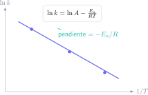

La Cinética responde a una pregunta distinta de la Termoquímica: no pregunta si una reacción puede ocurrir, sino a qué velocidad ocurre. Dos reacciones pueden ser energéticamente favorables y, aun así, una de ellas avanzar de forma imperceptible si la barrera de activación es alta.

Para una reacción con reactivos $A$ y $B$, una ley experimental de velocidad puede tener la forma

$$
v=k[A]^m[B]^n.
$$

Los exponentes $m$ y $n$ no se deducen de los coeficientes estequiométricos salvo en pasos elementales. Hay que obtenerlos experimentalmente o a partir de los datos que proporcione el problema.

## Ejercicio resuelto 1: hallar la ley de velocidad

En un experimento se observa que al duplicar $[A]$ manteniendo $[B]$ fija, la velocidad se cuadruplica. Al duplicar $[B]$ manteniendo $[A]$ fija, la velocidad se duplica. Entonces

$$
2^m=4\Rightarrow m=2,
\qquad 2^n=2\Rightarrow n=1.
$$

La ley es

$$
v=k[A]^2[B],
$$

y el orden global es $2+1=3$. Si se triplica $[A]$ y se mantiene $[B]$, la velocidad se multiplica por $3^2=9$, no por tres.

## Ejercicio resuelto 2: reacción de primer orden

Para una reacción de primer orden,

$$
\ln\frac{[A]_t}{[A]_0}=-kt.
$$

Si $k=0,231\,\mathrm{min^{-1}}$, ¿qué fracción queda tras $6,0\,\mathrm{min}$? Sustituimos:

$$
\ln\frac{[A]_t}{[A]_0}=-(0,231)(6,0)=-1,386.
$$

Por tanto,

$$
\frac{[A]_t}{[A]_0}=e^{-1,386}\approx0,250.
$$

Queda el $25\%$ del reactivo inicial. La vida media también se puede comprobar:

$$
t_{1/2}=\frac{\ln2}{k}=3,00\,\mathrm{min}.
$$

Han pasado dos vidas medias, así que debe quedar $(1/2)^2=1/4$. Esta segunda vía es una comprobación muy útil.

## Ejercicio resuelto 3: comparar temperaturas con Arrhenius

La ecuación de Arrhenius es

$$
k=Ae^{-E_a/(RT)}.
$$

Para evitar conocer $A$, se usa la forma de dos temperaturas:

$$
\ln\frac{k_2}{k_1}=-\frac{E_a}{R}\left(\frac1{T_2}-\frac1{T_1}\right).
$$

Sea $E_a=50,0\,\mathrm{kJ/mol}$, $T_1=298\,\mathrm{K}$ y $T_2=318\,\mathrm{K}$. Hay que convertir la energía a julios: $E_a=50000\,\mathrm{J/mol}$. Entonces

$$
\ln\frac{k_2}{k_1}
=-\frac{50000}{8,314}\left(\frac1{318}-\frac1{298}\right)
\approx1,27.
$$

Así,

$$
\frac{k_2}{k_1}\approx e^{1,27}\approx3,6.
$$

Un aumento de solo $20\,\mathrm{K}$ multiplica la constante por aproximadamente $3,6$. Por eso la temperatura tiene un efecto tan marcado en procesos industriales y biológicos.

## Qué interpretación pide un buen examen

- El orden indica cómo responde la velocidad a la concentración, no el mecanismo completo.
- La constante $k$ depende de la temperatura; una concentración no.
- Un catalizador reduce la energía de activación efectiva y acelera ambos sentidos de una reacción, pero no cambia el equilibrio termodinámico.
- En Arrhenius, las temperaturas se expresan siempre en kelvin.

En el [campus virtual de Método Nebula](/contacto/) puedes repasar Química con ejercicios que separan datos, modelo y unidades antes de hacer cuentas. Es especialmente útil en Cinética, donde un planteamiento correcto vale más que memorizar una ecuación integrada.
