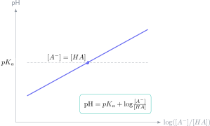

Una disolución tampón no “mantiene el pH exactamente constante”. Resiste cambios moderados de pH porque contiene un ácido débil y su base conjugada, o una base débil y su ácido conjugado. El detalle importante en los ejercicios es el orden: primero reacciona estequiométricamente el ácido o la base añadidos; después se aplica el equilibrio.

Para un tampón ácido $HA/A^-$, la ecuación de Henderson–Hasselbalch es

$$
\mathrm{pH}=pK_a+\log\frac{[A^-]}{[HA]}.
$$

Es especialmente fiable cuando ambas especies están presentes en cantidades apreciables y el cociente puede expresarse mediante moles, pues el volumen se cancela si es común.

## Ejercicio resuelto 1: pH de un tampón inicial

Se mezclan cantidades que proporcionan $0,20\,\mathrm{mol}$ de ácido acético $HA$ y $0,10\,\mathrm{mol}$ de acetato $A^-$. Si $pK_a=4,76$:

$$
\mathrm{pH}=4,76+\log\frac{0,10}{0,20}
=4,76+\log(0,5).
$$

Como $\log(0,5)\approx-0,301$,

$$
\mathrm{pH}\approx4,46.
$$

Hay más ácido que base conjugada, por eso el pH es menor que $pK_a$. Si ambas cantidades fuesen iguales, el cociente sería uno y el pH coincidiría con $pK_a$.

## Ejercicio resuelto 2: añadir ácido fuerte

Al tampón anterior se le añaden $0,020\,\mathrm{mol}$ de HCl. El ácido fuerte reacciona prácticamente por completo con el acetato:

$$
A^-+H^+\longrightarrow HA.
$$

La tabla de moles después de la reacción es

$$
n(A^-)=0,10-0,020=0,080,
$$

$$
n(HA)=0,20+0,020=0,220.
$$

Solo ahora aplicamos Henderson–Hasselbalch:

$$
\mathrm{pH}=4,76+\log\frac{0,080}{0,220}
\approx4,32.
$$

El pH baja, pero solo unas décimas. Aplicar directamente la fórmula con los moles iniciales e ignorar la reacción con HCl sería químicamente incorrecto.

## Ejercicio resuelto 3: añadir base fuerte

Supongamos de nuevo el tampón inicial y añadimos $0,030\,\mathrm{mol}$ de NaOH. Ahora la reacción relevante es

$$
HA+OH^-\longrightarrow A^-+H_2O.
$$

Tras la estequiometría:

$$
n(HA)=0,20-0,030=0,170,
\qquad n(A^-)=0,10+0,030=0,130.
$$

Por tanto,

$$
\mathrm{pH}=4,76+\log\frac{0,130}{0,170}\approx4,64.
$$

La base ha aumentado el pH, pero el ácido débil la ha neutralizado en gran parte transformándose en su base conjugada.

## Cuándo deja de funcionar el tampón

La capacidad tampón no es infinita. Si añadiéramos más de $0,10\,\mathrm{mol}$ de ácido al primer sistema, se agotaría todo el acetato. Ya no habría pareja $HA/A^-$ en cantidades suficientes y Henderson–Hasselbalch dejaría de describir la situación. En ese punto habría que calcular el exceso de ácido fuerte o replantear el equilibrio que quede.

También conviene recordar:

- usa $pK_a=-\log K_a$, no $K_a$ directamente en la ecuación;
- no mezcles concentración molar y moles en un mismo cociente sin justificar el volumen;
- verifica que el ácido o la base añadidos no consumen por completo uno de los componentes;
- expresa el resultado con sentido químico: añadir ácido debe disminuir el pH.

El [campus virtual de Método Nebula](/contacto/) incluye rutas de Química con teoría clara, ejercicios resueltos y problemas de examen que separan la reacción previa del equilibrio. Esa estructura ayuda a construir soluciones rigurosas y no solo a acertar una fórmula.
