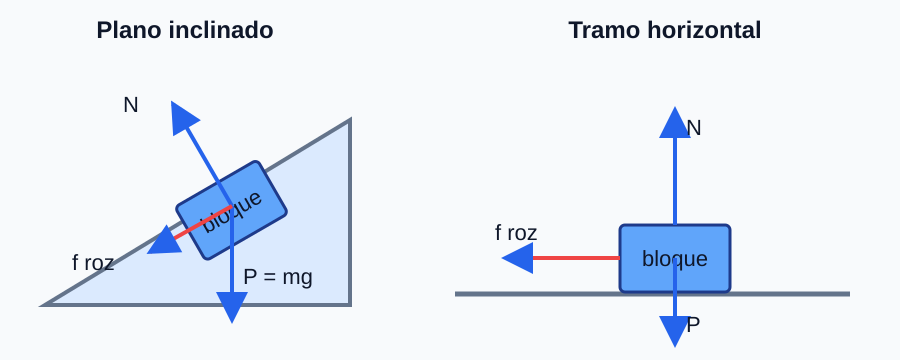
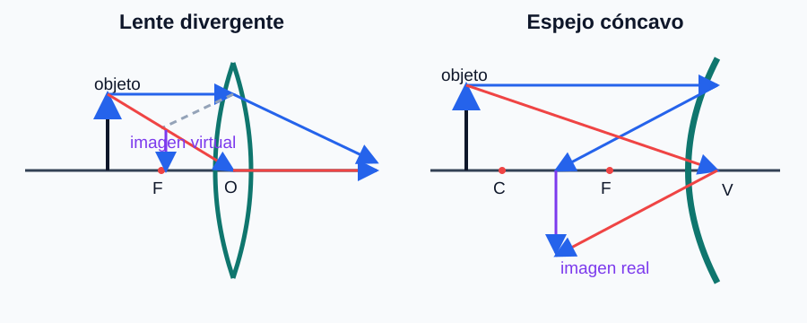

## Ejercicio 1

### Enunciado

**(a)** Razone si son verdaderas: i) El trabajo total de las fuerzas no conservativas es igual a la variación de la energía mecánica. ii) Siempre que actúen fuerzas no conservativas la energía mecánica varía.

**(b)** Un bloque de $150\ \text{kg}$ desliza por una superficie horizontal con rozamiento, con velocidad inicial $3\ \text{m·s}^{-1}$ hacia la derecha. Sobre él actúa una fuerza de $20\ \text{N}$ dirigida hacia la izquierda y formando $30^\circ$ sobre la horizontal; recorre $25\ \text{m}$ hasta detenerse. i) Esquema de fuerzas. ii) Variaciones de energía cinética, potencial y mecánica. iii) Trabajo de cada fuerza.

### Esquema para el apartado gráfico

### Solución explicada

**(a)** i) **Verdadera**: $W_{\text{no cons}}=\Delta E_m$ (el trabajo de las fuerzas no conservativas iguala la variación de energía mecánica). ii) **Falsa**: una fuerza no conservativa perpendicular al desplazamiento (p. ej. la normal) no realiza trabajo y no cambia $E_m$.

**(b)** El movimiento es horizontal, luego $\Delta E_p=0$.

ii) Variación de energía cinética (parte de $3\ \text{m·s}^{-1}$ y se detiene):
$$\Delta E_c=0-\dfrac12(150)(3)^2=-675\ \text{J};\qquad \Delta E_p=0;\qquad \Delta E_m=\Delta E_c=-675\ \text{J}$$

iii) Trabajos:
- Peso y normal: perpendiculares al desplazamiento $\Rightarrow W=0$.
- Fuerza aplicada de $20\ \text{N}$ (componente horizontal $20\cos30^\circ$ opuesta al movimiento):
$$W_F=-20\cos30^\circ\cdot25=-433\ \text{J}$$
- Rozamiento: por el teorema de la energía cinética $W_{\text{total}}=\Delta E_c$:
$$W_{roz}=\Delta E_c-W_F=-675-(-433)=-242\ \text{J}$$

## Ejercicio 2

### Enunciado

**(a)** i) Deduzca la velocidad de escape desde la superficie de un planeta. ii) La masa y el radio de la Tierra son $81$ y $3{,}67$ veces los de la Luna. ¿Qué relación hay entre las velocidades de escape de la Tierra y de la Luna?

**(b)** Se quiere un satélite estacionario alrededor de Júpiter (mismo periodo que el planeta). Un día en Júpiter es $0{,}41$ días terrestres y $M_J=318\,M_T$. Determine: i) el radio orbital alrededor de Júpiter; ii) la relación entre los radios orbitales de satélites estacionarios de la Tierra y de Júpiter.

### Solución explicada

**(a)** i) Por conservación de energía, escapar significa llegar al infinito con velocidad nula: $\dfrac12 m v_e^2-\dfrac{GMm}{R}=0$, de donde
$$v_e=\sqrt{\dfrac{2GM}{R}}$$
ii) Como $v_e\propto\sqrt{M/R}$:
$$\dfrac{v_{e,T}}{v_{e,L}}=\sqrt{\dfrac{M_T/R_T}{M_L/R_L}}=\sqrt{\dfrac{81}{3{,}67}}=4{,}70$$

**(b)** i) Satélite estacionario: $T=T_J=0{,}41\cdot24\cdot3600=35\,424\ \text{s}$. De la 3ª ley de Kepler $T^2=\dfrac{4\pi^2}{GM_J}r^3$:
$$r=\left(\dfrac{GM_J T^2}{4\pi^2}\right)^{1/3}=\left(\dfrac{6{,}67\cdot10^{-11}\cdot1{,}9\cdot10^{27}\cdot(35\,424)^2}{4\pi^2}\right)^{1/3}=1{,}59\cdot10^{8}\ \text{m}$$
ii) Como $r\propto(M T^2)^{1/3}$:
$$\dfrac{r_J}{r_T}=\left(\dfrac{M_J T_J^2}{M_T T_T^2}\right)^{1/3}=\left(318\cdot0{,}41^2\right)^{1/3}=3{,}77$$

## Ejercicio 3

### Enunciado

**(a)** Razone: i) ¿Puede ser nulo el flujo magnético a través de una espira en una región con campo magnético? ii) Si la f.e.m. inducida es nula en un instante, ¿implica que no hay flujo en ese instante?

**(b)** Una bobina de $100$ espiras circulares de radio $5\ \text{cm}$ está en un campo uniforme dirigido según su eje, de módulo $B(t)=0{,}1-0{,}1t^2$ (SI). Determine: i) el flujo en $t=2\ \text{s}$; ii) la f.e.m. inducida en $t=2\ \text{s}$; iii) el instante en que la f.e.m. es nula.

### Solución explicada

**(a)** i) **Sí**: si el campo es paralelo al plano de la espira, $\vec B\perp\vec S$ y $\Phi=\vec B\cdot\vec S=0$ aunque exista campo. ii) **No**: la f.e.m. depende de la **variación** del flujo ($\varepsilon=-d\Phi/dt$); puede ser nula justo cuando el flujo es máximo o mínimo, momento en que el flujo no es nulo.

**(b)** Área de una espira: $A=\pi R^2=\pi(0{,}05)^2=7{,}85\cdot10^{-3}\ \text{m}^2$.

i) Flujo total ($N$ espiras), con $B(2)=0{,}1-0{,}1\cdot4=-0{,}3\ \text{T}$:
$$\Phi=N B A=100\cdot(-0{,}3)\cdot7{,}85\cdot10^{-3}=-0{,}236\ \text{Wb}$$

ii) f.e.m.: $\varepsilon=-N A\dfrac{dB}{dt}$, con $\dfrac{dB}{dt}=-0{,}2t$. En $t=2\ \text{s}$:
$$\varepsilon=-100\cdot7{,}85\cdot10^{-3}\cdot(-0{,}2\cdot2)=0{,}314\ \text{V}$$

iii) $\varepsilon=0$ cuando $\dfrac{dB}{dt}=-0{,}2t=0\Rightarrow t=0\ \text{s}$.

## Ejercicio 4

### Enunciado

**(a)** Explique qué es una superficie equipotencial y qué forma tienen las del campo de una carga puntual. Razone el trabajo de la fuerza eléctrica sobre una carga que se mueve por una equipotencial.

**(b)** Dos cargas iguales de $-1{,}2\cdot10^{-6}\ \text{C}$ están en $A(0,8)\ \text{m}$ y $B(6,0)\ \text{m}$. Una tercera carga de $-1{,}5\cdot10^{-6}\ \text{C}$ está en $P(3,4)\ \text{m}$. Calcule: i) la fuerza eléctrica total sobre la carga en $P$ (con esquema); ii) el trabajo del campo para traer la tercera carga desde el infinito hasta $P$.

### Esquema para el apartado gráfico

### Solución explicada

**(a)** Una **superficie equipotencial** es el lugar geométrico de puntos con el mismo potencial. Para una carga puntual son **esferas concéntricas** centradas en la carga. El trabajo de la fuerza eléctrica sobre una carga que se mueve por una equipotencial es **nulo**, porque $W=q(V_i-V_f)=0$ si $V_i=V_f$ (la fuerza es perpendicular al desplazamiento).

**(b)** Las distancias $A\!\to\!P$ y $B\!\to\!P$ son iguales: $\sqrt{3^2+4^2}=5\ \text{m}$.

i) Cada carga ejerce (ambas negativas, como $q_P$: repulsión):
$$F=\dfrac{K|q_A q_P|}{r^2}=\dfrac{9\cdot10^{9}\cdot1{,}2\cdot10^{-6}\cdot1{,}5\cdot10^{-6}}{5^2}=6{,}48\cdot10^{-4}\ \text{N}$$
$\vec F_A$ va de $A$ a $P$: dirección $(3,-4)/5$; $\vec F_B$ va de $B$ a $P$: dirección $(-3,4)/5$. Al sumar:
$$\vec F_{\text{total}}=\vec F_A+\vec F_B=\vec 0$$
Las componentes se cancelan por simetría: la fuerza total sobre $P$ es nula.

ii) Potencial en $P$ creado por $q_A$ y $q_B$:
$$V_P=2\cdot\dfrac{K q_A}{5}=2\cdot\dfrac{9\cdot10^{9}\cdot(-1{,}2\cdot10^{-6})}{5}=-4320\ \text{V}$$
Trabajo del campo al traer $q_P$ desde el infinito:
$$W=q_P(V_\infty-V_P)=(-1{,}5\cdot10^{-6})(0-(-4320))=-6{,}48\cdot10^{-3}\ \text{J}$$

## Ejercicio 5

### Enunciado

**(a)** Demuestre, a partir de la ecuación de onda, cómo varían la velocidad y la aceleración máximas de oscilación: i) si se duplica la amplitud sin cambiar el periodo; ii) si se duplica la frecuencia sin cambiar la amplitud.

**(b)** En una cuerda se propaga $y(x,t)=0{,}2\cos(0{,}2x+0{,}25t+\varphi)$ (SI). Calcule: i) la frecuencia y la longitud de onda; ii) la velocidad de propagación, con dirección y sentido; iii) la velocidad máxima de oscilación.

### Solución explicada

**(a)** Velocidad de oscilación máxima $v_{\max}=A\omega$; aceleración máxima $a_{\max}=A\omega^2$.

i) Si $A\to2A$ con $T$ (y $\omega$) constante: $v_{\max}$ se **duplica** y $a_{\max}$ se **duplica**.

ii) Si $f\to2f$ (es decir $\omega\to2\omega$) con $A$ constante: $v_{\max}=A\omega$ se **duplica**, y $a_{\max}=A\omega^2$ se **cuadruplica**.

**(b)** i) $\omega=0{,}25\ \text{rad·s}^{-1}\Rightarrow f=\dfrac{\omega}{2\pi}=0{,}040\ \text{Hz}$. $k=0{,}2\ \text{rad·m}^{-1}\Rightarrow \lambda=\dfrac{2\pi}{k}=31{,}4\ \text{m}$.

ii) $v=\dfrac{\omega}{k}=\dfrac{0{,}25}{0{,}2}=1{,}25\ \text{m·s}^{-1}$. Como $x$ y $t$ aparecen con el **mismo** signo ($0{,}2x+0{,}25t$), la onda se propaga en el **sentido negativo** del eje $x$.

iii) $v_{\max}=A\omega=0{,}2\cdot0{,}25=0{,}05\ \text{m·s}^{-1}$.

## Ejercicio 6

### Enunciado

**(a)** Un rayo monocromático duplica su longitud de onda al pasar del medio 1 al 2. i) Determine la relación entre los índices de refracción. ii) ¿El rayo se acerca o se aleja de la normal? ¿Puede haber reflexión total?

**(b)** Sobre una lámina planoparalela rodeada de aire incide un rayo con $80^\circ$ respecto a la normal. En la lámina su longitud de onda es $3\lambda_0/4$ ($\lambda_0$ en el aire). i) Índice de refracción de la lámina. ii) Ángulo de refracción en la lámina (con esquema). iii) Espesor de la lámina si el rayo tarda $5{,}28\cdot10^{-10}\ \text{s}$ en atravesarla.

### Esquema para el apartado gráfico

### Solución explicada

**(a)** i) Como $n=c/v$ y $v=\lambda f$ (misma $f$), $\dfrac{n_1}{n_2}=\dfrac{\lambda_2}{\lambda_1}=2$, es decir $n_1=2n_2$. ii) Al pasar a un medio de **menor índice** ($n_2<n_1$) el rayo se **aleja de la normal**; además puede darse **reflexión total** si el ángulo supera el ángulo límite.

**(b)** i) Como la frecuencia no cambia, $n_{\text{lámina}}=\dfrac{\lambda_0}{\lambda_{\text{lámina}}}=\dfrac{\lambda_0}{3\lambda_0/4}=\dfrac{4}{3}=1{,}33$.

ii) Ley de Snell $n_{\text{aire}}\sin80^\circ=n_{\text{lámina}}\sin\theta_r$:
$$\sin\theta_r=\dfrac{\sin80^\circ}{4/3}=0{,}739\ \Rightarrow\ \theta_r=47{,}6^\circ$$

iii) La velocidad en la lámina es $v=\dfrac{c}{n}=\dfrac{3\cdot10^{8}}{4/3}=2{,}25\cdot10^{8}\ \text{m·s}^{-1}$. El camino recorrido dentro es $L=v t=2{,}25\cdot10^{8}\cdot5{,}28\cdot10^{-10}=0{,}119\ \text{m}$. El espesor (perpendicular) es:
$$d=L\cos\theta_r=0{,}119\cdot\cos47{,}6^\circ=0{,}080\ \text{m}=8{,}0\ \text{cm}$$

## Ejercicio 7

### Enunciado

**(a)** Justifique cuál de estas reacciones NO produce los productos indicados: i) $^{14}_{7}\text{N}+n\rightarrow\,^{14}_{6}\text{C}+p$; ii) $^{28}_{14}\text{Si}+\alpha\rightarrow\,^{29}_{15}\text{P}+n$.

**(b)** i) Determine $c$ y $Z$ en: $^{235}_{92}\text{U}+^{1}_{0}n\rightarrow\,^{145}_{Z}\text{La}+^{88}_{35}\text{Br}+c\,^{1}_{0}n$. ii) Calcule la energía liberada al fisionarse un millón de núcleos.

### Solución explicada

**(a)** Deben conservarse el número másico $A$ y el atómico $Z$.
- i) $A$: $14+1=15=14+1$ ✓; $Z$: $7+0=7=6+1$ ✓. **Posible.**
- ii) $A$: $28+4=32$, pero productos $29+1=30$; no se conserva ($Z$ tampoco: $16\neq15$). **No produce** esos productos.

**(b)** i) Conservación de $A$: $235+1=145+88+c\Rightarrow c=3$. Conservación de $Z$: $92=Z+35\Rightarrow Z=57$ ($^{145}_{57}\text{La}$).

ii) Defecto de masa por fisión (con $c=3$, hay $2$ neutrones netos de más en los productos):
$$\Delta m=m(^{235}\text{U})+m_n-m(^{145}\text{La})-m(^{88}\text{Br})-3m_n$$
$$\Delta m=235{,}043930-144{,}921651-87{,}924074-2\cdot1{,}008665=0{,}18088\ \text{u}$$
Energía por fisión: $E_1=\Delta m\cdot1{,}66\cdot10^{-27}\cdot(3\cdot10^{8})^2=2{,}70\cdot10^{-11}\ \text{J}$.
Para un millón ($10^{6}$) de núcleos:
$$E=10^{6}\cdot2{,}70\cdot10^{-11}=2{,}70\cdot10^{-5}\ \text{J}$$

## Ejercicio 8

### Enunciado

**(a)** Dos partículas tienen la misma energía cinética. Deduzca la relación entre sus longitudes de onda de De Broglie si la masa de la primera es un tercio de la de la segunda.

**(b)** Un protón se mueve a $3{,}8\cdot10^{3}\ \text{m·s}^{-1}$. Determine: i) su longitud de onda de De Broglie; ii) la energía cinética de un electrón con el mismo momento lineal que el protón; iii) la velocidad de ese electrón.

### Solución explicada

**(a)** $\lambda=\dfrac{h}{p}=\dfrac{h}{\sqrt{2mE_c}}$. Con la misma $E_c$ y $m_1=\dfrac{m_2}{3}$:
$$\dfrac{\lambda_1}{\lambda_2}=\sqrt{\dfrac{m_2}{m_1}}=\sqrt{3}\ \Rightarrow\ \lambda_1=\sqrt3\,\lambda_2$$
La partícula más ligera tiene mayor longitud de onda.

**(b)** i) $\lambda_p=\dfrac{h}{m_p v_p}=\dfrac{6{,}63\cdot10^{-34}}{1{,}67\cdot10^{-27}\cdot3{,}8\cdot10^{3}}=1{,}04\cdot10^{-10}\ \text{m}$.

ii) Mismo momento $p=m_p v_p=6{,}35\cdot10^{-24}\ \text{kg·m·s}^{-1}$. Para el electrón:
$$E_c=\dfrac{p^2}{2m_e}=\dfrac{(6{,}35\cdot10^{-24})^2}{2\cdot9{,}1\cdot10^{-31}}=2{,}21\cdot10^{-17}\ \text{J}$$

iii) $v_e=\dfrac{p}{m_e}=\dfrac{6{,}35\cdot10^{-24}}{9{,}1\cdot10^{-31}}=6{,}97\cdot10^{6}\ \text{m·s}^{-1}$.
