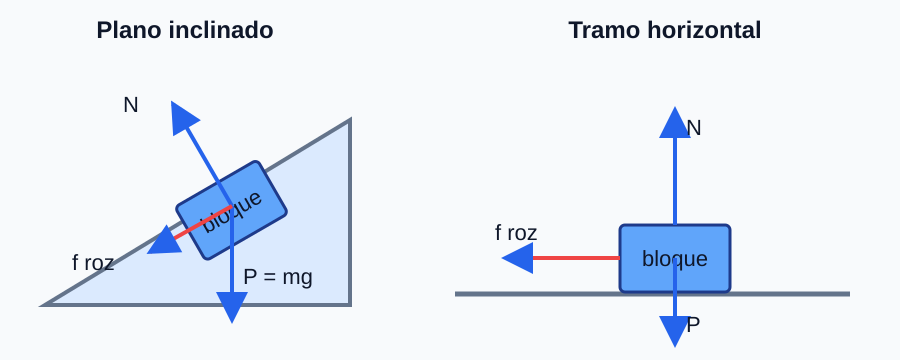

## Ejercicio 1

### Enunciado

**(a)** La galaxia Andrómeda tiene una masa $1{,}5$ veces la de la Vía Láctea; a escala galáctica se tratan como masas puntuales. (i) Justifique si existe un punto entre ambas donde se anule el campo gravitatorio y, en su caso, la relación entre las distancias de ese punto a cada galaxia. (ii) ¿Se anula el potencial gravitatorio en algún punto entre ambas?

**(b)** Se sitúa una masa de $3\ \text{kg}$ en $A(0,-2)\ \text{m}$ y otra de $2\ \text{kg}$ en $B(3,0)\ \text{m}$. Calcule en el origen: (i) el campo gravitatorio; (ii) el potencial gravitatorio.

### Solución explicada

**(a)(i)** El campo se anula donde los módulos se igualan. Si $d_1$ es la distancia a la Vía Láctea (masa $M$) y $d_2$ a Andrómeda (masa $1{,}5M$):
$$\dfrac{G M}{d_1^2} = \dfrac{G\,(1{,}5M)}{d_2^2} \;\Rightarrow\; \dfrac{d_1}{d_2} = \sqrt{\dfrac{1}{1{,}5}} = 0{,}816$$
Sí existe, más cerca de la galaxia menos masiva (la Vía Láctea).

**(a)(ii)** El potencial gravitatorio es siempre negativo (suma de términos $-GM/d$); entre las dos masas nunca se anula (solo en el infinito).

**(b)** Distancias al origen: $r_A = 2\ \text{m}$ (según $-y$ desde $A$) y $r_B = 3\ \text{m}$ (según $+x$ desde $B$). Cada campo apunta hacia su masa.
$$\vec{g}_A = \dfrac{G\,3}{2^2}\,(0,-1) = (0,\,-5{,}00\cdot10^{-11})\ \text{N·kg}^{-1}$$
$$\vec{g}_B = \dfrac{G\,2}{3^2}\,(1,0) = (1{,}48\cdot10^{-11},\,0)\ \text{N·kg}^{-1}$$
$$\vec{g} = (1{,}48\cdot10^{-11},\,-5{,}00\cdot10^{-11})\ \text{N·kg}^{-1}, \quad |\vec{g}| = 5{,}22\cdot10^{-11}\ \text{N·kg}^{-1}$$
Potencial (escalar):
$$V = -G\left(\dfrac{3}{2} + \dfrac{2}{3}\right) = -6{,}67\cdot10^{-11}\cdot2{,}167 = -1{,}45\cdot10^{-10}\ \text{J·kg}^{-1}$$

## Ejercicio 2

### Enunciado

**(a)** Razone si son verdaderos: (i) Si sobre una partícula solo actúan fuerzas conservativas, su energía mecánica aumenta. (ii) Si solo actúa el rozamiento (opuesto al desplazamiento), la energía mecánica aumenta.

**(b)** Una masa de $5\ \text{kg}$ se lanza hacia abajo por un plano inclinado sin rozamiento de $15^\circ$ con velocidad inicial $3\ \text{m·s}^{-1}$. Tras recorrer $2\ \text{m}$ por el plano llega a una superficie horizontal con rozamiento; tras recorrer $2\ \text{m}$ sobre ella su velocidad es $1\ \text{m·s}^{-1}$. (i) Dibuje las fuerzas en cada tramo. (ii) Calcule el trabajo del rozamiento en el tramo horizontal. (iii) Calcule el coeficiente de rozamiento en el tramo horizontal.

### Esquema para el apartado gráfico

### Solución explicada

**(a)** (i) FALSO: con solo fuerzas conservativas la energía mecánica se CONSERVA (constante), no aumenta. (ii) FALSO: el rozamiento opuesto al movimiento realiza trabajo negativo, por lo que la energía mecánica DISMINUYE.

**(b)(i)** En el plano: peso $m\vec{g}$ (descompuesto), normal $\vec{N}$ (no hay rozamiento). En la horizontal: peso, normal y fuerza de rozamiento $\vec{F}_r$ opuesta al movimiento.

**(b)(ii)** En el plano (sin rozamiento) la velocidad al final, por conservación de energía (desciende $h = 2\operatorname{sen}15^\circ$):
$$v_1^2 = v_0^2 + 2g\,(2\operatorname{sen}15^\circ) = 3^2 + 2\cdot9{,}8\cdot2\cdot0{,}259 = 19{,}1 \;\Rightarrow\; v_1 = 4{,}38\ \text{m·s}^{-1}$$
En la horizontal, el trabajo del rozamiento es la variación de energía cinética:
$$W_r = \tfrac12 m v_f^2 - \tfrac12 m v_1^2 = \tfrac12\cdot5\,(1^2 - 19{,}1) = -45{,}4\ \text{J}$$

**(b)(iii)** El rozamiento vale $F_r = \mu\,m g$ y $W_r = -F_r\,d$:
$$\mu = \dfrac{|W_r|}{m g\,d} = \dfrac{45{,}4}{5\cdot9{,}8\cdot2} = 0{,}46$$

## Ejercicio 3

### Enunciado

**(a)** Razone la veracidad: (i) En una espira de radio $R$ con su plano perpendicular a un campo $B(t) = a t + b$ se induce una f.e.m. constante. (ii) Al situar una espira en reposo en un campo magnético variable con el tiempo siempre se induce f.e.m.

**(b)** Una espira circular de $20\ \text{cm}$ de radio está en el plano $XY$ con un campo $B(t) = 3t^2 - 2t$ (S.I.) en sentido $-OZ$. (i) Obtenga el flujo magnético $\Phi(t)$. (ii) Calcule la f.e.m. inducida en $t = 2\ \text{s}$. (iii) Razone el sentido de la corriente.

### Solución explicada

**(a)(i)** VERDADERO: con $B(t)=at+b$, $\Phi=B\,S=(at+b)S$ y $\varepsilon=-\dfrac{\mathrm{d}\Phi}{\mathrm{d}t}=-a\,S$, que es constante.

**(a)(ii)** VERDADERO en general, siempre que la espira abarque flujo del campo (plano no paralelo al campo): un $B$ variable produce flujo variable y, por Faraday, f.e.m. inducida.

**(b)(i)** Área $S = \pi R^2 = \pi(0{,}20)^2 = 0{,}1257\ \text{m}^2$. El flujo (en módulo):
$$\Phi(t) = B(t)\,S = (3t^2 - 2t)\cdot0{,}1257\ \text{Wb}$$

**(b)(ii)** F.e.m. inducida:
$$\varepsilon = -\dfrac{\mathrm{d}\Phi}{\mathrm{d}t} = -S\,(6t - 2)$$
En $t = 2\ \text{s}$:
$$\varepsilon = -0{,}1257\,(6\cdot2 - 2) = -0{,}1257\cdot10 = -1{,}26\ \text{V} \;\Rightarrow\; |\varepsilon| = 1{,}26\ \text{V}$$

**(b)(iii)** En $t=2\ \text{s}$ el campo (en $-OZ$) crece en módulo ($\mathrm{d}B/\mathrm{d}t=6t-2=10>0$), luego el flujo entrante aumenta; por la ley de Lenz la corriente inducida circula de modo que se opone a ese aumento, creando un campo en $+OZ$ dentro de la espira (sentido antihorario visto desde $+Z$).

## Ejercicio 4

### Enunciado

**(a)** Un electrón se mueve en línea recta y penetra en una región con un campo eléctrico y otro magnético perpendiculares entre sí. Explique la relación entre los campos y la velocidad para que la trayectoria siga siendo rectilínea.

**(b)** Por dos conductores rectilíneos muy largos, paralelos y separados $2\ \text{m}$, circulan corrientes de $1\ \text{A}$ y $3\ \text{A}$. Determine a qué distancia del primer hilo se anula el campo magnético: (i) si las corrientes van en el mismo sentido; (ii) si van en sentidos opuestos.

### Solución explicada

**(a)** Para que el electrón siga recto, la fuerza de Lorentz total debe anularse: la fuerza eléctrica $q\vec{E}$ y la magnética $q\vec{v}\times\vec{B}$ han de ser iguales y opuestas. En módulo:
$$|q|E = |q|\,v\,B \;\Rightarrow\; v = \dfrac{E}{B}$$
(con $\vec{E}\perp\vec{B}$ y $\vec{v}\perp$ a ambos). Es el fundamento del selector de velocidades.

**(b)** El campo de cada hilo es $B = \dfrac{\mu_0 I}{2\pi r}$. Se anula donde $\dfrac{I_1}{r_1} = \dfrac{I_2}{r_2}$, con $r_1+r_2=2$ (entre los hilos) o $r_2 = r_1 + 2$ (fuera).

(i) **Mismo sentido:** los campos se oponen ENTRE los hilos. Sea $x$ la distancia al hilo de $1\ \text{A}$:
$$\dfrac{1}{x} = \dfrac{3}{2-x} \;\Rightarrow\; 2 - x = 3x \;\Rightarrow\; x = 0{,}5\ \text{m}$$

(ii) **Sentidos opuestos:** los campos se oponen FUERA, en el lado del hilo de menor corriente. Con $r_2 = x+2$:
$$\dfrac{1}{x} = \dfrac{3}{x+2} \;\Rightarrow\; x + 2 = 3x \;\Rightarrow\; x = 1\ \text{m}$$
(a $1\ \text{m}$ del hilo de $1\ \text{A}$, en el lado opuesto al otro hilo).

## Ejercicio 5

### Enunciado

**(a)** Construya la imagen formada en un espejo cóncavo para un objeto situado a una distancia mayor que su radio de curvatura, explicando el trazado de rayos, e indique las características de la imagen.

**(b)** Un objeto de $4\ \text{cm}$ se sitúa a $36\ \text{cm}$ de una lente delgada convergente de distancia focal $12\ \text{cm}$. (i) Calcule la posición y el tamaño de la imagen, indicando el criterio de signos. (ii) Realice el trazado de rayos e indique las características de la imagen.

### Esquema para el apartado gráfico

### Solución explicada

**(a)** Para un objeto más allá del centro de curvatura $C$ ($|s|>R=2f$): el rayo paralelo al eje se refleja pasando por el foco $F$; el rayo que pasa por $C$ vuelve sobre sí mismo. Su intersección da una imagen REAL, INVERTIDA y REDUCIDA, situada entre el foco $F$ y el centro $C$.

**(b)(i)** Criterio de signos: la luz viaja de izquierda a derecha; distancias positivas a la derecha de la lente. Objeto real: $s=-36\ \text{cm}$; lente convergente: $f'=+12\ \text{cm}$.
$$\dfrac{1}{s'} - \dfrac{1}{s} = \dfrac{1}{f'} \;\Rightarrow\; \dfrac{1}{s'} = \dfrac{1}{12} + \dfrac{1}{-36} = \dfrac{2}{36} \;\Rightarrow\; s' = 18\ \text{cm}$$
Aumento y tamaño:
$$m = \dfrac{s'}{s} = \dfrac{18}{-36} = -0{,}5 \;\Rightarrow\; y' = m\,y = -0{,}5\cdot4 = -2\ \text{cm}$$

**(b)(ii)** La imagen es REAL ($s'>0$), INVERTIDA ($m<0$) y REDUCIDA ($|m|<1$), a $18\ \text{cm}$ a la derecha de la lente.

## Ejercicio 6

### Enunciado

**(a)** Explique las diferencias entre ondas longitudinales y transversales, con un ejemplo de cada tipo.

**(b)** Un oleaje se propaga en el sentido $+OX$. Una boya en $x = 10\ \text{m}$ oscila verticalmente con amplitud $0{,}4\ \text{m}$ y periodo $2\ \text{s}$; la velocidad de propagación es $0{,}5\ \text{m·s}^{-1}$. Determine: (i) la longitud de onda; (ii) la ecuación de onda suponiendo que en $t=0$ la boya está en su altura máxima; (iii) la velocidad máxima de oscilación de la boya.

### Solución explicada

**(a)** En una onda LONGITUDINAL la vibración del medio es paralela a la dirección de propagación (ejemplo: sonido en el aire). En una onda TRANSVERSAL la vibración es perpendicular a la propagación (ejemplo: ondas en una cuerda o el oleaje).

**(b)(i)** Longitud de onda:
$$\lambda = v\,T = 0{,}5\cdot2 = 1\ \text{m}$$

**(b)(ii)** Con $\omega = \dfrac{2\pi}{T} = \pi\ \text{rad·s}^{-1}$ y $k = \dfrac{2\pi}{\lambda} = 2\pi\ \text{m}^{-1}$, y máximo en la boya ($x=10\ \text{m}$) en $t=0$, se usa coseno con la fase ajustada:
$$y(x,t) = 0{,}4\cos\!\big[\pi\,t - 2\pi\,(x - 10)\big]\ \text{m}$$
(en $x=10$, $t=0$: $y = 0{,}4\cos 0 = 0{,}4\ \text{m}$, máximo).

**(b)(iii)** La velocidad de oscilación es $v_y = \dfrac{\partial y}{\partial t}$, de módulo máximo
$$v_{y,\max} = A\,\omega = 0{,}4\cdot\pi \approx 1{,}26\ \text{m·s}^{-1}$$

## Ejercicio 7

### Enunciado

**(a)** Razone: (i) La energía de los fotoelectrones es la misma que la de los fotones absorbidos. (ii) Al irradiar un metal con luz blanca (con efecto fotoeléctrico en todo el rango), la mayor energía cinética corresponde a los fotoelectrones de la región del rojo.

**(b)** Al iluminar un metal con luz de frecuencia $2{,}5\cdot10^{15}\ \text{Hz}$ el potencial de frenado es $7{,}20\ \text{V}$; con luz de longitud de onda $1{,}8\cdot10^{-7}\ \text{m}$ el potencial baja a $3{,}75\ \text{V}$. Determine: (i) la constante de Planck; (ii) el trabajo de extracción del metal.

### Solución explicada

**(a)(i)** FALSO: parte de la energía del fotón se invierte en extraer el electrón (trabajo de extracción $\phi$); la energía cinética máxima es $E_{c,\max} = h f - \phi < h f$.

**(a)(ii)** FALSO: la energía cinética máxima crece con la frecuencia. En la luz blanca la mayor frecuencia (y mayor $E_c$) corresponde al VIOLETA, no al rojo.

**(b)(i)** Con $E_{c,\max}=eV$: $h f = \phi + eV$. Para las dos luces ($f_2 = c/\lambda_2 = 1{,}667\cdot10^{15}\ \text{Hz}$) y restando:
$$h(f_1 - f_2) = e(V_1 - V_2) \;\Rightarrow\; h = \dfrac{e(V_1 - V_2)}{f_1 - f_2} = \dfrac{1{,}6\cdot10^{-19}(7{,}20-3{,}75)}{2{,}5\cdot10^{15}-1{,}667\cdot10^{15}}$$
$$h = 6{,}62\cdot10^{-34}\ \text{J·s}$$

**(b)(ii)** Trabajo de extracción:
$$\phi = h f_1 - e V_1 = 6{,}62\cdot10^{-34}\cdot2{,}5\cdot10^{15} - 1{,}6\cdot10^{-19}\cdot7{,}20 = 5{,}04\cdot10^{-19}\ \text{J} \approx 3{,}15\ \text{eV}$$

## Ejercicio 8

### Enunciado

**(a)** Explique el concepto de defecto de masa, su expresión matemática y su relación con la estabilidad nuclear.

**(b)** (i) Calcule la energía de enlace por nucleón de los nucleidos $^{3}_{1}\text{H}$ y $^{3}_{2}\text{He}$. (ii) Indique razonadamente cuál es más estable.

### Solución explicada

**(a)** El defecto de masa $\Delta m$ es la diferencia entre la masa de los nucleones por separado y la masa del núcleo: $\Delta m = (Z\,m_p + N\,m_n) - M_{\text{núcleo}}$. Esa masa "desaparecida" se transforma en la energía de enlace $E_e = \Delta m\,c^2$, que mantiene unido el núcleo. Cuanto mayor es la energía de enlace POR NUCLEÓN, más estable es el núcleo.

**(b)(i)** Para $^{3}_{1}\text{H}$ ($Z=1$, $N=2$):
$$\Delta m = 1\cdot1{,}007276 + 2\cdot1{,}008665 - 3{,}016049 = 0{,}008557\ \text{u}$$
$$E_e = \Delta m\,c^2 = 0{,}008557\cdot1{,}66\cdot10^{-27}\cdot(3\cdot10^{8})^2 = 1{,}28\cdot10^{-12}\ \text{J}$$
Por nucleón: $\dfrac{E_e}{3} = 4{,}26\cdot10^{-13}\ \text{J} \approx 2{,}66\ \text{MeV/nucleón}$.

Para $^{3}_{2}\text{He}$ ($Z=2$, $N=1$):
$$\Delta m = 2\cdot1{,}007276 + 1\cdot1{,}008665 - 3{,}016029 = 0{,}007188\ \text{u}$$
$$E_e = 0{,}007188\cdot1{,}66\cdot10^{-27}\cdot(3\cdot10^{8})^2 = 1{,}07\cdot10^{-12}\ \text{J}$$
Por nucleón: $\dfrac{E_e}{3} = 3{,}58\cdot10^{-13}\ \text{J} \approx 2{,}23\ \text{MeV/nucleón}$.

**(b)(ii)** Con los datos del enunciado, $^{3}_{1}\text{H}$ tiene mayor energía de enlace por nucleón ($2{,}66$ frente a $2{,}23\ \text{MeV}$), luego resulta el más estable según este cálculo.
