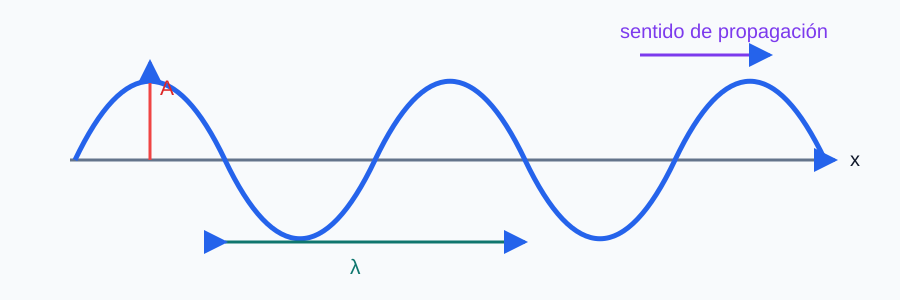

## Ejercicio 1

### Enunciado

**Teoría T1.** Explique el concepto de energía potencial gravitatoria.

### Solución explicada

La fuerza gravitatoria es **conservativa**, por lo que puede asociarse a ella una energía potencial $E_p$ tal que el trabajo que realiza el campo entre dos puntos es $W=-\Delta E_p=E_{p,i}-E_{p,f}$.

Para dos masas puntuales $M$ y $m$ separadas una distancia $r$, tomando el origen de energías en el infinito ($E_p(\infty)=0$), la energía potencial es:

$$E_p=-\dfrac{GMm}{r}$$

Es **negativa** porque se ha de aportar energía para separar las masas hasta el infinito; mide el trabajo (cambiado de signo) necesario para traer $m$ desde el infinito hasta $r$. Se relaciona con el potencial gravitatorio $V=-\dfrac{GM}{r}$ mediante $E_p=mV$.

Propiedades: solo depende de las posiciones (no del camino); disminuye al acercarse las masas (el campo hace trabajo positivo) y aumenta (se hace menos negativa) al alejarlas. Para alturas pequeñas cerca de la superficie terrestre se recupera la aproximación $E_p\approx mgh$.

## Ejercicio 2

### Enunciado

**Teoría T2.** Enuncie las leyes de Faraday y de Lenz de la inducción electromagnética.

### Solución explicada

**Ley de Faraday.** Toda variación del flujo magnético $\Phi=\displaystyle\int \vec{B}\cdot d\vec{S}$ a través de un circuito induce en él una fuerza electromotriz (fem) proporcional a la rapidez con que cambia dicho flujo:

$$\varepsilon=-\dfrac{d\Phi}{dt}$$

Para una bobina de $N$ espiras, $\varepsilon=-N\dfrac{d\Phi}{dt}$. El flujo puede variar por cambio de $B$, del área $S$ o del ángulo entre $\vec{B}$ y $\vec{S}$.

**Ley de Lenz.** El signo negativo indica el sentido de la corriente inducida: esta se opone a la variación de flujo que la genera. La corriente inducida crea un campo magnético que tiende a mantener el flujo (si el flujo aumenta, se opone; si disminuye, lo refuerza). Es una consecuencia de la conservación de la energía: el sistema reacciona oponiéndose al cambio, de modo que hay que realizar trabajo para producir la corriente.

## Ejercicio 3

### Enunciado

**Teoría T3.** Clasifique los distintos tipos de ondas.

### Solución explicada

Una onda es la propagación de una perturbación que transporta energía y cantidad de movimiento sin transporte neto de materia. Se clasifican según varios criterios:

**Según el medio de propagación:**
- *Mecánicas*: necesitan un medio material (sonido, ondas en cuerdas, sísmicas, en el agua).
- *Electromagnéticas*: se propagan también en el vacío (luz, ondas de radio, rayos X); son campos $\vec{E}$ y $\vec{B}$ oscilantes.

**Según la dirección de vibración respecto a la de propagación:**
- *Transversales*: la perturbación es perpendicular a la propagación (luz, onda en una cuerda).
- *Longitudinales*: la perturbación es paralela a la propagación (sonido).

**Según las dimensiones de propagación:** unidimensionales (cuerda), bidimensionales (superficie del agua) y tridimensionales (sonido, luz).

**Según su frente de onda:** planas, cilíndricas o esféricas.

Además pueden distinguirse ondas *armónicas* (perturbación sinusoidal) y, por su duración, *pulsos* frente a *trenes de onda*.

## Ejercicio 4

### Enunciado

**Teoría T4.** Enuncie los postulados de la relatividad especial y sus principales repercusiones.

### Solución explicada

**Postulados de Einstein (1905):**
1. *Principio de relatividad*: las leyes de la física son las mismas en todos los sistemas de referencia inerciales.
2. *Constancia de la velocidad de la luz*: la velocidad de la luz en el vacío $c$ es la misma para todos los observadores inerciales, independientemente del movimiento de la fuente o del observador.

**Repercusiones principales** (con $\gamma=\dfrac{1}{\sqrt{1-v^2/c^2}}$):

- *Dilatación del tiempo*: un intervalo propio $\Delta t_0$ se mide dilatado por otro observador, $\Delta t=\gamma\,\Delta t_0$.
- *Contracción de la longitud*: una longitud propia $L_0$ se mide contraída en la dirección del movimiento, $L=\dfrac{L_0}{\gamma}$.
- *Relatividad de la simultaneidad*: sucesos simultáneos en un sistema no lo son en otro.
- *Equivalencia masa-energía*: $E=mc^2$; la energía total es $E=\gamma m c^2$ y el momento $p=\gamma m v$.
- Ningún cuerpo con masa puede alcanzar la velocidad $c$.

## Ejercicio 5

### Enunciado

**Cuestión C1.** Calcule el periodo (en días) y la velocidad orbital de la Luna en su trayectoria alrededor de la Tierra.

### Solución explicada

La atracción gravitatoria de la Tierra actúa como fuerza centrípeta de la órbita circular de la Luna:

$$\dfrac{GM_T M_L}{r^2}=M_L\dfrac{v^2}{r}\ \Rightarrow\ v=\sqrt{\dfrac{GM_T}{r}}=\sqrt{\dfrac{6{,}67\cdot10^{-11}\cdot6{,}0\cdot10^{24}}{3{,}84\cdot10^{8}}}=1{,}02\cdot10^{3}\ \text{m·s}^{-1}$$

El periodo se obtiene de $v=\dfrac{2\pi r}{T}$:

$$T=\dfrac{2\pi r}{v}=\dfrac{2\pi\cdot3{,}84\cdot10^{8}}{1{,}02\cdot10^{3}}=2{,}36\cdot10^{6}\ \text{s}$$

Pasando a días:

$$T=\dfrac{2{,}36\cdot10^{6}}{86400}\approx27{,}4\ \text{días}$$

## Ejercicio 6

### Enunciado

**Cuestión C2.** Un altavoz emite ondas sonoras con potencia $450\ \text{W}$. Calcule la distancia mínima a la que debemos colocarnos para no superar el umbral de dolor ($120\ \text{dB}$).

### Solución explicada

El umbral de dolor corresponde a una intensidad obtenida de $\beta=10\log_{10}(I/I_0)$:

$$I=I_0\cdot10^{\beta/10}=10^{-12}\cdot10^{120/10}=10^{-12}\cdot10^{12}=1\ \text{W·m}^{-2}$$

Para una fuente puntual (onda esférica) $I=\dfrac{P}{4\pi d^2}$, de donde la distancia mínima:

$$d=\sqrt{\dfrac{P}{4\pi I}}=\sqrt{\dfrac{450}{4\pi\cdot1}}=5{,}98\ \text{m}\approx6{,}0\ \text{m}$$

## Ejercicio 7

### Enunciado

**Cuestión C3.** Cuatro conductores rectilíneos perpendiculares al plano, con la misma intensidad, están en los vértices de un cuadrado. Dibuje cualitativamente el campo magnético que cada corriente crea en el centro y el campo total en los dos supuestos A y B de la figura (indique con palabras si el campo es nulo).

### Esquema para el apartado gráfico

### Solución explicada

Cada hilo crea en el centro un campo de módulo $B=\dfrac{\mu_0 I}{2\pi d}$, siendo $d$ la distancia del vértice al centro (la misma para los cuatro). La **dirección** es perpendicular a la recta vértice-centro y el **sentido** lo da la regla de la mano derecha según entre o salga la corriente del plano.

**Supuesto A** (por ejemplo, corrientes con sentidos alternados o dispuestas de forma simétrica): los campos de hilos diametralmente opuestos tienen la misma recta soporte. Cuando dos hilos opuestos llevan corrientes en el mismo sentido, sus campos en el centro son **opuestos y se cancelan**; si las cuatro contribuciones se anulan dos a dos, el **campo total es nulo**.

**Supuesto B** (corrientes dispuestas de modo que las contribuciones se suman): los vectores no se cancelan y el campo total es la suma vectorial, resultando un campo **no nulo** dirigido según la simetría del conjunto (por ejemplo, a lo largo de una diagonal o de una mediana del cuadrado).

La clave es: (1) dibujar cada $\vec{B}_i$ perpendicular al radio vértice-centro con el sentido de la mano derecha, y (2) sumarlos vectorialmente. Donde la simetría empareja vectores iguales y opuestos, el resultado es cero.

## Ejercicio 8

### Enunciado

**Cuestión C4.** Dos partículas, $A$ de masa $m$ y $B$ de masa $3m$, tienen la misma longitud de onda de De Broglie. Determine el cociente $v_B/v_A$.

### Solución explicada

La longitud de onda de De Broglie de una partícula es $\lambda=\dfrac{h}{p}=\dfrac{h}{mv}$. Igualando las longitudes de onda:

$$\dfrac{h}{m_A v_A}=\dfrac{h}{m_B v_B}\ \Rightarrow\ m_A v_A=m_B v_B$$

Es decir, tienen el mismo momento lineal. Despejando el cociente:

$$\dfrac{v_B}{v_A}=\dfrac{m_A}{m_B}=\dfrac{m}{3m}=\dfrac{1}{3}$$

## Ejercicio 9

### Enunciado

**Problema P1.** El positrón ($e^+$) es idéntico al electrón salvo el signo de su carga (positiva).

**(a)** Con un $e^-$ y un $e^+$ en reposo separados $7\ \text{nm}$, calcule la energía que hay que aportar para separarlos una distancia infinita.

**(b)** Se acelera un positrón desde el reposo con un campo eléctrico constante de $2840\ \text{V·m}^{-1}$. ¿Qué distancia recorre para alcanzar $1000\ \text{m·s}^{-1}$?

**(c)** Anulado el campo eléctrico, el positrón se mueve a $1000\ \text{m·s}^{-1}$ perpendicular al campo magnético terrestre de $50\ \mu\text{T}$. Determine el radio de su trayectoria.

### Solución explicada

**(a)** La energía potencial eléctrica del par ($+e$ y $-e$) a distancia $d_0$ es:

$$U=\dfrac{k\,(+e)(-e)}{d_0}=\dfrac{9\cdot10^{9}\cdot(1{,}6\cdot10^{-19})(-1{,}6\cdot10^{-19})}{7\cdot10^{-9}}=-3{,}29\cdot10^{-20}\ \text{J}$$

Para separarlos hasta el infinito ($U_\infty=0$) hay que aportar:

$$W=U_\infty-U=0-(-3{,}29\cdot10^{-20})=3{,}29\cdot10^{-20}\ \text{J}$$

**(b)** La aceleración por la fuerza eléctrica es $a=\dfrac{eE}{m_e}=\dfrac{1{,}6\cdot10^{-19}\cdot2840}{9{,}1\cdot10^{-31}}=4{,}99\cdot10^{14}\ \text{m·s}^{-2}$. Con $v^2=2ad$:

$$d=\dfrac{v^2}{2a}=\dfrac{(1000)^2}{2\cdot4{,}99\cdot10^{14}}=1{,}0\cdot10^{-9}\ \text{m}=1{,}0\ \text{nm}$$

**(c)** En el campo magnético la fuerza de Lorentz es centrípeta, $R=\dfrac{m_e v}{eB}$:

$$R=\dfrac{9{,}1\cdot10^{-31}\cdot1000}{1{,}6\cdot10^{-19}\cdot50\cdot10^{-6}}=1{,}14\cdot10^{-4}\ \text{m}$$

## Ejercicio 10

### Enunciado

**Problema P2.** Por una cuerda se propaga una onda armónica en sentido $+x$. La Figura 1 representa la elongación $y(x)$ en $t=0$ y la Figura 2 la elongación $y(t)$ en la posición $x=2\ \text{cm}$. De las gráficas se leen: amplitud $A=2\ \text{cm}$, longitud de onda $\lambda=8\ \text{cm}$ y periodo $T=4\ \text{s}$.

**(a)** Determine la longitud de onda, la frecuencia y la velocidad de propagación.

**(b)** Escriba la ecuación de la onda $y(x,t)$.

**(c)** Calcule la velocidad de vibración máxima y la aceleración máxima de un punto de la cuerda.

### Esquema para el apartado gráfico

### Solución explicada

**(a)** Lectura de las gráficas: de la Figura 1, $\lambda=8\ \text{cm}=0{,}08\ \text{m}$; de la Figura 2, $T=4\ \text{s}$. Entonces:

$$f=\dfrac{1}{T}=\dfrac{1}{4}=0{,}25\ \text{Hz},\qquad v=\lambda f=\dfrac{\lambda}{T}=\dfrac{0{,}08}{4}=0{,}02\ \text{m·s}^{-1}$$

**(b)** Con $\omega=2\pi f=\dfrac{2\pi}{4}=1{,}57\ \text{rad·s}^{-1}$ y $k=\dfrac{2\pi}{\lambda}=\dfrac{2\pi}{0{,}08}=78{,}5\ \text{rad·m}^{-1}$. Para una onda que avanza en $+x$:

$$y(x,t)=0{,}02\,\operatorname{sen}\!\left(1{,}57\,t-78{,}5\,x\right)\ \text{m}$$

**(c)** Las magnitudes máximas de oscilación de un punto:

$$v_{\max}=A\,\omega=0{,}02\cdot1{,}57=3{,}1\cdot10^{-2}\ \text{m·s}^{-1}$$

$$a_{\max}=A\,\omega^2=0{,}02\cdot(1{,}57)^2=4{,}9\cdot10^{-2}\ \text{m·s}^{-2}$$

## Ejercicio 11

### Enunciado

**Problema P3.** Una lente de cámara tiene focal $50\ \text{mm}$, índice $1{,}6$ y es planoconvexa.

**(a)** Determine el radio de curvatura de la cara curva.

**(b)** ¿A qué distancia de la lente hay que poner un objeto para que su imagen tenga la mitad de tamaño (en valor absoluto)?

**(c)** Si un rayo incide desde el aire sobre la cara plana con $45^\circ$ respecto a la normal, ¿qué ángulo forma dentro de la lente con la normal?

### Solución explicada

**(a)** Ecuación del constructor de lentes. Planoconvexa: una cara plana ($R_1\to\infty$) y una curva de radio $R$:

$$\dfrac{1}{f'}=(n-1)\left(\dfrac{1}{R_1}-\dfrac{1}{R_2}\right)\ \Rightarrow\ \dfrac{1}{f'}=\dfrac{n-1}{R}\ \Rightarrow\ R=(n-1)\,f'=(1{,}6-1)\cdot50=30\ \text{mm}$$

**(b)** Imagen reducida y real (lente convergente): $M=\dfrac{s'}{s}=-\dfrac12$, luego $s'=-\dfrac{s}{2}$. Sustituyendo en $\dfrac{1}{s'}-\dfrac{1}{s}=\dfrac{1}{f'}$:

$$-\dfrac{2}{s}-\dfrac{1}{s}=\dfrac{1}{f'}\ \Rightarrow\ -\dfrac{3}{s}=\dfrac{1}{f'}\ \Rightarrow\ s=-3f'=-150\ \text{mm}$$

El objeto debe colocarse a $150\ \text{mm}=15\ \text{cm}$ delante de la lente (la imagen se forma a $s'=75\ \text{mm}$).

**(c)** Ley de Snell en la cara plana, aire→vidrio:

$$\operatorname{sen}45^\circ=n\operatorname{sen}\theta\ \Rightarrow\ \operatorname{sen}\theta=\dfrac{\operatorname{sen}45^\circ}{1{,}6}=0{,}442\ \Rightarrow\ \theta=26{,}2^\circ$$

## Ejercicio 12

### Enunciado

**Problema P4.** El $^{131}_{53}\text{I}$ y el $^{223}_{88}\text{Ra}$ se usan contra el cáncer y experimentan desintegración $\beta^-$ y $\alpha$ respectivamente.

**(a)** Escriba ambas reacciones indicando $A$, $Z$ y $N$ de los núcleos resultantes.

**(b)** Si de $1\ \text{mg}$ de $^{131}\text{I}$ quedan $0{,}66\ \text{mg}$ tras $5\ \text{días}$, determine la vida media del $^{131}\text{I}$.

**(c)** Calcule, en julios, la energía liberada en la desintegración $\alpha$ de un núcleo de $^{223}\text{Ra}$.

### Solución explicada

**(a)** En la $\beta^-$ el núcleo emite un electrón (un neutrón se convierte en protón): $Z$ aumenta en 1, $A$ no cambia.

$$^{131}_{53}\text{I}\ \longrightarrow\ ^{131}_{54}\text{Xe}+{}^{\ 0}_{-1}e+\bar{\nu}_e$$

El núcleo resultante tiene $A=131$, $Z=54$, $N=77$.

En la $\alpha$ se emite un núcleo de helio ($^4_2\text{He}$): $A$ disminuye en 4 y $Z$ en 2.

$$^{223}_{88}\text{Ra}\ \longrightarrow\ ^{219}_{86}\text{Rn}+{}^{4}_{2}\text{He}$$

El $^{219}_{86}\text{Rn}$ tiene $A=219$, $Z=86$, $N=133$.

**(b)** De $N=N_0 e^{-\lambda t}$ con $N/N_0=0{,}66$ y $t=5\ \text{días}$:

$$\lambda=-\dfrac{\ln(0{,}66)}{5}=0{,}0831\ \text{días}^{-1}$$

La vida media es $\tau=\dfrac{1}{\lambda}=\dfrac{1}{0{,}0831}=12{,}0\ \text{días}$. (El periodo de semidesintegración sería $T_{1/2}=\tau\ln 2\approx8{,}3\ \text{días}$.)

**(c)** Defecto de masa de la $\alpha$:

$$\Delta m=M(\text{Ra})-M(\text{Rn})-M(\text{He})=223{,}0185-219{,}0095-4{,}0026=6{,}4\cdot10^{-3}\ \text{u}$$

Energía liberada $Q=\Delta m\,c^2$:

$$Q=6{,}4\cdot10^{-3}\cdot1{,}66\cdot10^{-27}\cdot(3\cdot10^{8})^2=9{,}56\cdot10^{-13}\ \text{J}$$
