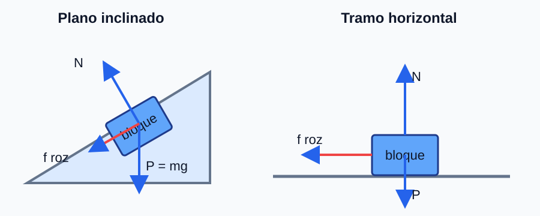

## Ejercicio 1

### Enunciado

**(a)** Razone la veracidad de: i) para que la energía mecánica se conserve es necesario que la resultante de todas las fuerzas sobre un cuerpo sea nula; ii) la energía mecánica se conserva cuando sobre un cuerpo actúan solo fuerzas conservativas.

**(b)** Un niño de $15\ \text{kg}$ resbala desde el reposo por un tobogán de $2\ \text{m}$ de altura inclinado $30^\circ$. Con coeficiente de rozamiento dinámico $0{,}25$: i) haga un esquema de fuerzas y determine el trabajo de la fuerza de rozamiento; ii) calcule la energía cinética al final y la velocidad de llegada.

### Esquema para el apartado gráfico

### Solución explicada

**(a)** i) **Falsa.** La energía mecánica se conserva si no actúan fuerzas no conservativas (como el rozamiento), aunque la resultante no sea nula; por ejemplo, en caída libre la resultante (el peso) no es nula y la energía mecánica se conserva. ii) **Verdadera.** Si solo actúan fuerzas conservativas, el trabajo total es $-\Delta E_p$ y la energía mecánica $E_m=E_c+E_p$ permanece constante.

**(b)** Sobre el niño actúan: peso $mg$, normal $N$ y rozamiento $F_r$ (opuesto al movimiento). La longitud del plano es $L=\dfrac{h}{\text{sen}\,30^\circ}=\dfrac{2}{0{,}5}=4\ \text{m}$. La normal:
$$N=mg\cos30^\circ=15\cdot9{,}8\cdot\cos30^\circ=127{,}3\ \text{N}$$
i) Trabajo del rozamiento ($F_r=\mu N$, opuesto al desplazamiento):
$$W_{roz}=-\mu N\,L=-0{,}25\cdot127{,}3\cdot4=-127{,}3\ \text{J}$$
ii) Por el teorema de la energía (parte del reposo), $E_c=mgh+W_{roz}$:
$$E_c=15\cdot9{,}8\cdot2-127{,}3=294-127{,}3=166{,}7\ \text{J}$$
$$v=\sqrt{\dfrac{2E_c}{m}}=\sqrt{\dfrac{2\cdot166{,}7}{15}}=4{,}71\ \text{m/s}$$

## Ejercicio 2

### Enunciado

Indique, razonando, si son ciertos: **i)** si el flujo magnético a través de una superficie es cero, entonces necesariamente el campo magnético es nulo; **ii)** la fuerza electromotriz inducida será no nula si el flujo es no nulo.

### Solución explicada

**i) Falsa.** El flujo es $\Phi=\displaystyle\int \vec{B}\cdot d\vec{S}=B\,S\cos\theta$. Puede ser cero sin que $\vec{B}$ lo sea:
- si $\vec{B}$ es perpendicular a la normal de la superficie ($\theta=90^\circ$, $\cos\theta=0$), o
- si las contribuciones positivas y negativas del flujo se compensan (por ejemplo, un campo que entra por una mitad y sale por la otra).

**ii) Falsa.** La fem inducida depende de la **variación** del flujo, no de su valor: $\varepsilon=-\dfrac{d\Phi}{dt}$. Un flujo grande pero **constante** da fem nula; y un flujo que pasa por cero puede, en ese instante, tener máxima rapidez de variación y, por tanto, máxima fem. Lo determinante es $d\Phi/dt$, no $\Phi$.

## Ejercicio 3

### Enunciado

Dos partículas idénticas de carga $q$ y masa $m$ están separadas una distancia $d$. Una se mantiene fija y la otra se aleja por la fuerza electrostática hasta duplicar la distancia inicial.

**(a)** Determine la expresión del módulo de la velocidad que adquiere la partícula en el punto final.

**(b)** Indique cómo cambiaría esa velocidad si se duplicara el valor de ambas cargas.

### Solución explicada

**(a)** Por conservación de la energía (parte del reposo). La energía potencial de dos cargas iguales a distancia $r$ es $E_p=\dfrac{k q^2}{r}$:
$$E_{p,i}=\dfrac{kq^2}{d}, \qquad E_{p,f}=\dfrac{kq^2}{2d}$$
La energía cinética final es $\tfrac12 m v^2=E_{p,i}-E_{p,f}$:
$$\tfrac12 m v^2 = \dfrac{kq^2}{d}-\dfrac{kq^2}{2d} = \dfrac{kq^2}{2d}$$
$$\boxed{v = \sqrt{\dfrac{kq^2}{m d}} = q\sqrt{\dfrac{k}{m d}}}$$

**(b)** Si ambas cargas se duplican ($q\to 2q$), $E_p\propto q^2$ y $v\propto q$. Como $v=q\sqrt{\dfrac{k}{md}}$, al duplicar $q$ la velocidad se **duplica** (en realidad $v\propto q$, de modo que $v_{nueva}=2v$).

## Ejercicio 4

### Enunciado

Una espira circular de área $40\ \text{cm}^2$ gira a $1500\ \text{rpm}$ alrededor de un diámetro perpendicular a un campo magnético uniforme de $0{,}25\ \text{T}$; su resistencia es $10\ \Omega$. En $t=0$ el flujo es máximo.

**(a)** Determine el flujo magnético en función del tiempo.

**(b)** Calcule la fem y la intensidad inducidas en función del tiempo. ¿La corriente es continua o alterna?

### Solución explicada

La velocidad angular:
$$\omega = 1500\,\dfrac{2\pi}{60} = 157\ \text{rad/s}$$

**(a)** Como en $t=0$ el flujo es máximo, $\Phi=B S\cos(\omega t)$:
$$\Phi(t) = 0{,}25\cdot 4\cdot10^{-3}\cos(157\,t) = 1{,}0\cdot10^{-3}\cos(157\,t)\ \text{Wb}$$

**(b)** Fem inducida (Faraday):
$$\varepsilon = -\dfrac{d\Phi}{dt} = B S\,\omega\,\text{sen}(\omega t) = 1{,}0\cdot10^{-3}\cdot157\,\text{sen}(157\,t) = 0{,}157\,\text{sen}(157\,t)\ \text{V}$$
Intensidad (ley de Ohm):
$$I = \dfrac{\varepsilon}{R} = \dfrac{0{,}157}{10}\,\text{sen}(157\,t) = 1{,}57\cdot10^{-2}\,\text{sen}(157\,t)\ \text{A}$$
La fem y la corriente son **sinusoidales**: la corriente es **alterna** (cambia periódicamente de sentido). Es el principio del alternador.

## Ejercicio 5

### Enunciado

Un electrón se lanza desde el infinito con velocidad inicial $10^{7}\ \text{m·s}^{-1}$ hacia una carga puntual de $-5\ \mu\text{C}$ fija.

**(a)** Determine la distancia a la carga en la que se anula la velocidad del electrón.

**(b)** Calcule el módulo y el carácter (atractiva o repulsiva) de la fuerza a esa distancia.

### Solución explicada

El electrón (carga $-e$) y la carga $Q$ (negativa) se **repelen**, por lo que el electrón se frena al acercarse. La energía potencial del par es $E_p=\dfrac{k(-e)(Q)}{r}=\dfrac{k\,e\,|Q|}{r}>0$ (ambas negativas).

**(a)** Conservación de la energía (en el infinito $E_p=0$, toda es cinética; en el punto de retorno $v=0$):
$$\tfrac12 m_e v_0^2 = \dfrac{k\,e\,|Q|}{r} \;\Rightarrow\; r = \dfrac{k\,e\,|Q|}{\tfrac12 m_e v_0^2}$$
$$\tfrac12 m_e v_0^2 = \tfrac12\cdot9{,}1\cdot10^{-31}\cdot(10^{7})^2 = 4{,}55\cdot10^{-17}\ \text{J}$$
$$r = \dfrac{9\cdot10^{9}\cdot1{,}6\cdot10^{-19}\cdot5\cdot10^{-6}}{4{,}55\cdot10^{-17}} = 158\ \text{m}$$

**(b)** La fuerza a esa distancia:
$$F = \dfrac{k\,e\,|Q|}{r^2} = \dfrac{9\cdot10^{9}\cdot1{,}6\cdot10^{-19}\cdot5\cdot10^{-6}}{158^2} = 2{,}9\cdot10^{-19}\ \text{N}$$
Es **repulsiva** (dos cargas negativas).

## Ejercicio 6

### Enunciado

Se sitúa un objeto luminoso delante de una lente divergente. Dibuje el trazado de rayos e indique razonadamente las características de la imagen obtenida.

### Esquema para el apartado gráfico

### Solución explicada

Una lente **divergente** tiene $f'<0$. Para un objeto real se trazan:

1. Rayo **paralelo** al eje: al salir diverge como si procediera del foco imagen $F'$ (situado en el mismo lado que el objeto); su prolongación pasa por $F'$.
2. Rayo que pasa por el **centro óptico**: no se desvía.

Las prolongaciones de los rayos emergentes se cortan en el lado del objeto. La imagen resulta:
- **Virtual** (formada por prolongaciones, no proyectable),
- **Derecha** (del mismo sentido que el objeto),
- **Menor** que el objeto y situada **entre la lente y el objeto**.

Esto ocurre para **cualquier** posición del objeto real, ya que con $\dfrac{1}{s'}-\dfrac{1}{s}=\dfrac{1}{f'}$ ($f'<0$, $s<0$) siempre resulta $s'<0$ y $0<m<1$.

## Ejercicio 7

### Enunciado

Una onda armónica pasa de un medio a otro y la longitud de onda en el segundo medio es la mitad que en el primero. Obtenga de forma justificada la relación entre: **i)** las velocidades de propagación en ambos medios; **ii)** la velocidad máxima de oscilación en ambos medios si no cambia la amplitud.

### Solución explicada

Al pasar de un medio a otro, la **frecuencia no cambia** (la impone la fuente): $f_1=f_2=f$.

**i)** Como $v=\lambda f$:
$$\dfrac{v_2}{v_1} = \dfrac{\lambda_2 f}{\lambda_1 f} = \dfrac{\lambda_2}{\lambda_1} = \dfrac{1}{2} \;\Rightarrow\; v_2 = \dfrac{v_1}{2}$$
La velocidad de propagación en el segundo medio es la mitad.

**ii)** La velocidad máxima de oscilación de un punto es $v_{osc,max}=A\,\omega=A\,2\pi f$. Como ni la amplitud $A$ ni la frecuencia $f$ cambian:
$$v_{osc,max,2} = v_{osc,max,1}$$
La velocidad máxima de oscilación es la **misma** en ambos medios.

## Ejercicio 8

### Enunciado

Se proyecta un objeto de $0{,}2\ \text{mm}$ con una lente convergente sobre una pantalla situada a $28\ \text{cm}$ a la derecha del objeto. La lente se coloca a $3{,}8\ \text{cm}$ del objeto.

**(a)** Determine la distancia focal de la lente para enfocar en la pantalla, indicando el criterio de signos.

**(b)** Determine el tamaño de la imagen.

### Solución explicada

Criterio de signos: distancias positivas a la derecha de la lente; objeto real $s=-3{,}8\ \text{cm}$; la pantalla está a $28-3{,}8=24{,}2\ \text{cm}$ a la derecha de la lente, $s'=+24{,}2\ \text{cm}$.

**(a)** Ecuación de la lente delgada:
$$\dfrac{1}{s'}-\dfrac{1}{s}=\dfrac{1}{f'} \;\Rightarrow\; \dfrac{1}{f'}=\dfrac{1}{24{,}2}-\dfrac{1}{-3{,}8}=\dfrac{1}{24{,}2}+\dfrac{1}{3{,}8}=0{,}3045\ \text{cm}^{-1}$$
$$f' = 3{,}28\ \text{cm}$$

**(b)** Aumento lateral:
$$m=\dfrac{s'}{s}=\dfrac{24{,}2}{-3{,}8}=-6{,}37 \;\Rightarrow\; y'=m\,y=-6{,}37\cdot0{,}2=-1{,}27\ \text{mm}$$
La imagen es real, invertida y de tamaño $|y'|\approx1{,}3\ \text{mm}$.

## Ejercicio 9

### Enunciado

La cuerda de una guitarra vibra según $y(x,t)=0{,}01\,\text{sen}(10\pi x)\cos(200\pi t)$ (SI).

**(a)** Indique qué tipo de onda es.

**(b)** Calcule la amplitud y la velocidad de propagación de las ondas cuya superposición da lugar a ella.

**(c)** Determine la velocidad de oscilación de un punto situado en $x=10\ \text{cm}$.

### Solución explicada

**(a)** El producto de una función solo de $x$ por otra solo de $t$ ($\text{sen}(kx)\cos(\omega t)$) corresponde a una **onda estacionaria**, resultado de la superposición de dos ondas iguales que viajan en sentidos opuestos.

**(b)** Comparando con $y=2A\,\text{sen}(kx)\cos(\omega t)$: la amplitud de cada onda componente cumple $2A=0{,}01\ \text{m}$, luego $A=5\cdot10^{-3}\ \text{m}$. Con $k=10\pi\ \text{rad/m}$ y $\omega=200\pi\ \text{rad/s}$:
$$v=\dfrac{\omega}{k}=\dfrac{200\pi}{10\pi}=20\ \text{m/s}$$

**(c)** La velocidad de oscilación es $v_y=\dfrac{\partial y}{\partial t}=-0{,}01\cdot200\pi\,\text{sen}(10\pi x)\,\text{sen}(200\pi t)$. En $x=0{,}10\ \text{m}$:
$$\text{sen}(10\pi\cdot0{,}10)=\text{sen}(\pi)=0 \;\Rightarrow\; v_y=0$$
El punto $x=10\ \text{cm}$ es un **nodo**: permanece en reposo (su velocidad de oscilación es nula en todo instante).

## Ejercicio 10

### Enunciado

Se produce emisión de fotoelectrones en un metal cuando la frecuencia mínima de la radiación corresponde a luz amarilla. Razone: **i)** ¿qué sucede si se irradia con luz roja? **ii)** ¿y si se aumenta la intensidad de la radiación amarilla?

### Solución explicada

La condición del efecto fotoeléctrico es $h f \ge W = h f_0$, con $f_0$ la frecuencia umbral. Aquí el umbral es la luz **amarilla**.

**i) Luz roja:** la luz roja tiene **menor frecuencia** que la amarilla ($f_{rojo}<f_{amarillo}=f_0$). Entonces cada fotón tiene energía $hf<W$ y **no hay emisión** de fotoelectrones, por intensa que sea la luz roja.

**ii) Más intensidad de luz amarilla:** aumentar la intensidad significa más **fotones por segundo**, pero cada fotón mantiene la misma energía $hf_0$. Por tanto se emiten **más fotoelectrones por unidad de tiempo** (mayor corriente), pero su **energía cinética máxima no cambia** (sigue siendo $E_{c,max}=hf_0-W=0$ en el umbral).

## Ejercicio 11

### Enunciado

Un protón tiene una masa $1{,}9$ veces mayor que la de un mesón K. Razone: **i)** si tuviesen la misma longitud de onda de De Broglie, ¿cuál tendría menor velocidad? **ii)** si tuviesen la misma velocidad, ¿cuál tendría menor longitud de onda?

### Solución explicada

La longitud de onda de De Broglie es $\lambda=\dfrac{h}{p}=\dfrac{h}{m v}$.

**i) Misma $\lambda$:** entonces $m v$ es igual para ambos: $m_p v_p = m_K v_K$. Como $m_p=1{,}9\,m_K$:
$$v_p = \dfrac{m_K}{m_p}v_K = \dfrac{v_K}{1{,}9} < v_K$$
El **protón** (más masivo) tiene **menor velocidad**.

**ii) Misma $v$:** $\lambda=\dfrac{h}{m v}$, luego $\lambda\propto\dfrac{1}{m}$. El de mayor masa tiene menor $\lambda$:
$$\lambda_p = \dfrac{\lambda_K}{1{,}9} < \lambda_K$$
El **protón** tiene **menor longitud de onda**.

## Ejercicio 12

### Enunciado

Una fotocélula de cobre se ilumina con dos radiaciones de frecuencias $f_1=9{,}6\cdot10^{14}\ \text{Hz}$ y $f_2=5{,}5\cdot10^{15}\ \text{Hz}$; el trabajo de extracción del cobre es $4{,}7\ \text{eV}$.

**(a)** ¿Cuál de las dos radiaciones produce efecto fotoeléctrico?

**(b)** Calcule la velocidad máxima de los fotoelectrones emitidos por la que lo produce.

### Solución explicada

La frecuencia umbral es $f_0=\dfrac{W}{h}=\dfrac{4{,}7\cdot1{,}6\cdot10^{-19}}{6{,}63\cdot10^{-34}}=1{,}13\cdot10^{15}\ \text{Hz}$.

**(a)** Comparando:
- $f_1=9{,}6\cdot10^{14}\ \text{Hz} < f_0$: **no** produce efecto fotoeléctrico.
- $f_2=5{,}5\cdot10^{15}\ \text{Hz} > f_0$: **sí** produce efecto fotoeléctrico.

**(b)** Para $f_2$, energía cinética máxima $E_c=hf_2-W$:
$$E_c = 6{,}63\cdot10^{-34}\cdot5{,}5\cdot10^{15}-7{,}52\cdot10^{-19} = 2{,}89\cdot10^{-18}\ \text{J}$$
$$v_{max} = \sqrt{\dfrac{2E_c}{m_e}} = \sqrt{\dfrac{2\cdot2{,}89\cdot10^{-18}}{9{,}1\cdot10^{-31}}} = 2{,}52\cdot10^{6}\ \text{m/s}$$

## Ejercicio 13

### Enunciado

Un protón y un electrón se aceleran mediante una diferencia de potencial de $0{,}075\ \text{V}$.

**(a)** Determine la energía cinética de ambas partículas.

**(b)** Determine, razonadamente, las longitudes de onda de De Broglie de ambas partículas.

### Solución explicada

**(a)** Ambas partículas tienen la misma carga en módulo ($e$), así que adquieren la **misma energía cinética**:
$$E_c = e\,\Delta V = 1{,}6\cdot10^{-19}\cdot0{,}075 = 1{,}2\cdot10^{-20}\ \text{J} = 0{,}075\ \text{eV}$$

**(b)** Con $E_c=\dfrac{p^2}{2m}$, el momento es $p=\sqrt{2mE_c}$ y la longitud de onda $\lambda=\dfrac{h}{\sqrt{2mE_c}}$. Como $E_c$ es igual, $\lambda\propto\dfrac{1}{\sqrt{m}}$; la partícula más ligera (electrón) tiene mayor $\lambda$:
$$\lambda_e = \dfrac{6{,}63\cdot10^{-34}}{\sqrt{2\cdot9{,}1\cdot10^{-31}\cdot1{,}2\cdot10^{-20}}} = 4{,}49\cdot10^{-9}\ \text{m} = 4{,}49\ \text{nm}$$
$$\lambda_p = \dfrac{6{,}63\cdot10^{-34}}{\sqrt{2\cdot1{,}67\cdot10^{-27}\cdot1{,}2\cdot10^{-20}}} = 1{,}05\cdot10^{-10}\ \text{m} = 0{,}105\ \text{nm}$$
