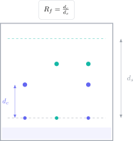

GCSE chemical analysis questions combine observation and conclusion. Recognising a colour is not enough: you must name the reagent, describe the positive result and justify the species identified. In chromatography, a small measuring error can also change the calculated $R_f$ value.

> **Direct answer.** Keep the procedure, observation and inference separate. In chromatography, measure from the origin line to the centre of the spot and compare values only when the solvent and conditions are the same.

## Question 1: calculate an Rf value

The solvent front travels $8.0\ \mathrm{cm}$ and a spot travels $5.6\ \mathrm{cm}$. Calculate $R_f$.

$$
R_f=\frac{\text{distance travelled by substance}}{\text{distance travelled by solvent}}
=\frac{5.6}{8.0}=0.70.
$$

$R_f$ has no unit because it is a ratio of two lengths. It must lie between 0 and 1; a value above 1 usually means that the distances were reversed.

## Question 2: identify a mixture

Under the same conditions, standard $A$ gives $R_f=0.42$ and standard $B$ gives $R_f=0.68$. An unknown sample produces two spots with $R_f=0.42$ and $0.69$.

The sample probably contains $A$ and $B$: both spots agree within experimental precision. It is also a mixture because it produces more than one spot.

Two substances cannot be proved identical from one matching $R_f$ alone. Chromatography provides evidence under specific conditions; another technique may be needed for a definitive identification.

## Question 3: test for a pure substance

A sample produces one spot on a chromatogram. Does this prove that it is pure?

One spot is **consistent** with a pure substance in that solvent, but it is not absolute proof. Two components might travel the same distance or one might not be visible. A rigorous conclusion must recognise this limitation.

For a substance with a known melting point, a narrow melting range close to the expected value provides additional purity evidence.

## Question 4: gas tests

Match each observation to the gas:

- A glowing splint relights: oxygen.
- A lit splint gives a squeaky pop: hydrogen.
- Limewater turns cloudy: carbon dioxide.
- Damp litmus paper is bleached: chlorine.

If the question asks for a procedure, do not state only the gas. For example: “bubble the gas through limewater; carbon dioxide is present if the limewater turns cloudy”.

## Question 5: identify a cation

A solution forms a blue precipitate when sodium hydroxide is added. Which ion does this suggest?

Within the GCSE test set, this is characteristic of $\mathrm{Cu^{2+}}$:

$$
\mathrm{Cu^{2+}(aq)+2OH^-(aq)\rightarrow Cu(OH)_2(s)}.
$$

A complete answer contains the reagent, observation and cation. “Blue copper” does not describe the procedure or distinguish the ion from the metal.

## Question 6: distinguish halides

A solution is acidified with dilute nitric acid and silver nitrate is then added. A cream precipitate forms.

The cream precipitate indicates bromide:

$$
\mathrm{Ag^+(aq)+Br^-(aq)\rightarrow AgBr(s)}.
$$

Nitric acid removes interfering ions without adding a halide. Hydrochloric acid would introduce chloride ions and could create a false precipitate.

## Choosing the test

| Aim | Suitable method | Evidence |
|---|---|---|
| Separate dyes | Chromatography | Number and position of spots |
| Identify a gas | Specific gas test | Observable change |
| Detect a halide | Acidified silver nitrate | Precipitate colour |
| Detect a metal cation | Sodium hydroxide | Precipitate colour and solubility |
| Assess purity | Melting point or chromatography | Range or number of components |

## Common errors

- Drawing the origin line with soluble ink.
- Placing the initial spots below the solvent level.
- Measuring to the edge rather than the centre of a spot.
- Comparing $R_f$ values from different solvents.
- Giving the conclusion without the reagent and observation.
- Using hydrochloric acid before a halide test.

The Método Nebula virtual campus connects chemical analysis, bonding, ions and reactions through visual theory, required practicals, graded exercises and worked GCSE questions. Use the contact button to access a bilingual route where each test is learnt as a chain of procedure, evidence and conclusion.
