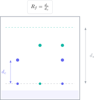

Las preguntas de análisis químico GCSE mezclan observación y conclusión. Reconocer un color no basta: hay que nombrar el reactivo, describir el resultado positivo y justificar qué especie identifica. En cromatografía, además, una medida pequeña puede cambiar el valor de $R_f$.

> **Respuesta directa.** Separa siempre procedimiento, observación e inferencia. En cromatografía mide desde la línea de origen hasta el centro de la mancha y compara valores solo cuando el disolvente y las condiciones son iguales.

## Ejercicio 1: calcular el valor de Rf

El frente del disolvente recorre $8.0\ \mathrm{cm}$ y una mancha recorre $5.6\ \mathrm{cm}$. Calcula $R_f$.

$$
R_f=\frac{\text{distancia recorrida por la sustancia}}{\text{distancia recorrida por el disolvente}}
=\frac{5.6}{8.0}=0.70.
$$

$R_f$ no lleva unidades porque es un cociente de dos longitudes. Debe quedar entre 0 y 1; un resultado mayor que 1 indica que se han invertido las distancias.

## Ejercicio 2: identificar una mezcla

En las mismas condiciones, un patrón $A$ produce una mancha con $R_f=0.42$ y un patrón $B$ otra con $R_f=0.68$. Una muestra desconocida produce dos manchas con $R_f=0.42$ y $0.69$.

La muestra contiene probablemente $A$ y $B$: las dos manchas coinciden dentro de la precisión experimental. También es una mezcla porque produce más de una mancha.

No puede afirmarse que dos sustancias sean idénticas solo por un $R_f$ coincidente. La cromatografía aporta evidencia bajo unas condiciones concretas; pueden necesitarse otras técnicas para una identificación definitiva.

## Ejercicio 3: detectar una sustancia pura

Una muestra da una sola mancha en un cromatograma. ¿Demuestra esto que es pura?

Una sola mancha es **compatible** con una sustancia pura en ese disolvente, pero no constituye una prueba absoluta. Dos componentes podrían desplazarse la misma distancia o uno podría no ser visible. La conclusión rigurosa debe reconocer esa limitación.

En sustancias con punto de fusión conocido, un intervalo estrecho cercano al valor esperado aporta evidencia adicional de pureza.

## Ejercicio 4: pruebas de gases

Relaciona cada observación con el gas:

- Una astilla incandescente se reaviva: oxígeno.
- Una astilla encendida produce un pequeño estallido: hidrógeno.
- El agua de cal se vuelve turbia: dióxido de carbono.
- El papel tornasol húmedo se decolora: cloro.

Si una pregunta pide el procedimiento, no escribas únicamente el nombre del gas. Por ejemplo: “hacer pasar el gas por agua de cal; si se vuelve turbia, hay dióxido de carbono”.

## Ejercicio 5: identificar un catión

Una disolución produce un precipitado azul al añadir hidróxido de sodio. ¿Qué ion sugiere?

El resultado es característico de $\mathrm{Cu^{2+}}$ en el conjunto de pruebas GCSE:

$$
\mathrm{Cu^{2+}(aq)+2OH^-(aq)\rightarrow Cu(OH)_2(s)}.
$$

La respuesta completa incluye reactivo, observación y catión. Escribir “cobre azul” no describe el procedimiento ni distingue el ion del metal.

## Ejercicio 6: distinguir haluros

Una disolución se acidifica con ácido nítrico diluido y después se añade nitrato de plata. Aparece un precipitado crema.

El precipitado crema indica bromuro:

$$
\mathrm{Ag^+(aq)+Br^-(aq)\rightarrow AgBr(s)}.
$$

El ácido nítrico elimina interferencias sin introducir iones haluro. Utilizar ácido clorhídrico contaminaría la prueba con cloruros y podría producir un falso precipitado.

## Cómo elegir la prueba

| Objetivo | Método adecuado | Evidencia |
|---|---|---|
| Separar colorantes | Cromatografía | Número y posición de manchas |
| Identificar un gas | Prueba específica | Cambio observable |
| Detectar haluro | Nitrato de plata acidificado | Color del precipitado |
| Detectar catión metálico | Hidróxido de sodio | Color y solubilidad del precipitado |
| Estimar pureza | Fusión o cromatografía | Intervalo o número de componentes |

## Errores frecuentes

- Dibujar la línea de origen con tinta soluble.
- Sumergir las manchas iniciales en el disolvente.
- Medir hasta el borde y no hasta el centro de la mancha.
- Comparar valores de $R_f$ obtenidos con disolventes distintos.
- Dar la conclusión sin reactivo ni observación.
- Usar ácido clorhídrico antes de la prueba de haluros.

El campus virtual de Método Nebula conecta análisis químico, enlace, iones y reacciones con teoría visual, prácticas obligatorias, ejercicios graduados y preguntas GCSE resueltas. El botón de contacto permite acceder a una ruta bilingüe donde cada prueba se aprende como una cadena de procedimiento, evidencia y conclusión.
