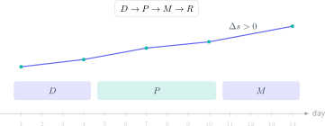

Missing a GCSE Maths pass by a few marks creates a dangerous temptation: revising the whole specification from page one. In fourteen days, that spreads effort too thinly. A better approach is to identify **which question types are blocking Grade 4 or 5**, repair them and prove the improvement under timed conditions.

> **Direct answer.** Split the fourteen days into diagnosis, priority practice, partial mocks and one full paper. Classify every lost mark as a concept, method, reading or calculation error so that it becomes a specific action.

## Day 1: turn the mark into a diagnosis

Complete a recent paper without notes and within the official time. A low starting mark is useful if it is honest. Mark it with the official scheme and create four columns: topic, marks available, marks earned and reason for the error.

Do not write “bad at algebra”. Record an actionable observation: “did not factorise before solving”, “used perimeter instead of area” or “rounded before the final answer”. The precision of the diagnosis determines the quality of the plan.

Measure performance in each topic group:

$$
r_i=\frac{\text{marks earned in group }i}{\text{marks available in group }i}.
$$

Prioritise groups with low $r_i$ and several accessible marks. A recurring three-mark skill is usually more valuable than one rare top-grade problem.

## Days 2–4: secure the foundation marks

At Foundation tier, fractions, percentages, ratio, proportion, linear equations, graphs, area, volume and basic statistics often decide the pass. Higher students also need reliable algebraic manipulation, quadratics, trigonometry and multi-step reasoning.

Use the same cycle for every micro-topic:

1. Rebuild the idea and formula for ten minutes.
2. Complete three untimed examples with every step shown.
3. Attempt four exam questions under time pressure.
4. Repeat one failed question the next day.

Delayed repetition shows whether you learnt the method or merely recognised yesterday's solution.

## Days 5–10: practise the way marks are awarded

Alternate 25–35 minute sets with immediate marking. Do not check an answer after every line. Finish the question, rate your confidence and then mark it. This trains the decision-making required in the real exam.

When the mark scheme rewards working, keep the substitution even when using a calculator:

$$
A=\pi r^2=\pi(4.2)^2=55.4\ \mathrm{cm^2}.
$$

Units, rounding and a contextual conclusion are part of the solution. A correct isolated number can still lose marks.

## Days 11–12: partial mocks

Combine questions from your three weakest groups into 45-minute papers. The purpose is not a record score; it is to keep the method when the topic changes. Record the time and calculate:

$$
v=\frac{\text{marks attempted}}{\text{minutes used}}.
$$

A very low rate often means that one difficult question is consuming the paper. Mark it, move on and return with the remaining time.

## Day 13: full paper and final decision

Complete a full paper under exam conditions. Compare the score with Day 1, but also inspect stability. Are signs, units or command words still costing marks? If an error returns, create one explicit check for exam day.

Reliable progress is not simply “feeling more confident”. It is earning more marks independently and within the allowed time.

## Day 14: light review, not a marathon

Review formulas, the error log and two representative questions. Do not attempt a new chapter. Prepare the permitted calculator and equipment, sleep properly and arrive with a clear timing strategy.

## A final check for every answer

- Estimate the order of magnitude before calculating.
- Substitute the value back into the original equation.
- Check that a probability lies between 0 and 1.
- Distinguish units of length, area and volume.
- Ask whether the result is sensible in context.

The Método Nebula virtual campus turns this schedule into a personal route: an initial diagnostic, concise theory, graded exercises, worked past papers and an error record. If Grade 4 or 5 is the target, the contact button can be used to build a fourteen-day route from your actual paper rather than a generic topic list.
