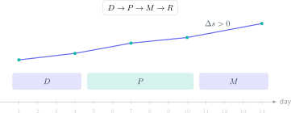

Suspender Matemáticas GCSE por unos pocos puntos produce una tentación peligrosa: volver a estudiar todo el temario desde la primera página. En catorce días eso dispersa el esfuerzo. La alternativa eficaz es localizar **qué tipos de pregunta están impidiendo llegar al Grade 4 o 5**, corregirlos y demostrar la mejora bajo tiempo real.

> **Respuesta directa.** Divide los catorce días en diagnóstico, práctica por prioridades, simulacros parciales y un examen completo. Cada error debe clasificarse como conceptual, de procedimiento, de lectura o de cálculo; solo así se convierte en una tarea concreta.

## Día 1: convierte la nota en un diagnóstico

Haz una prueba reciente sin apuntes y con el tiempo oficial. No importa que la puntuación inicial sea baja: necesitas una medida honesta. Corrige con el criterio oficial y crea una tabla con cuatro columnas: tema, puntos disponibles, puntos obtenidos y causa del error.

No escribas “se me da mal álgebra”. Es demasiado amplio. Registra observaciones operativas: “no factoricé antes de resolver”, “confundí área con perímetro” o “redondeé antes del resultado final”. La precisión del diagnóstico decide la calidad del plan.

Calcula también el rendimiento por bloque:

$$
r_i=\frac{\text{puntos obtenidos en el bloque }i}{\text{puntos disponibles en el bloque }i}.
$$

Prioriza los bloques con $r_i$ bajo y muchas preguntas accesibles. Una pregunta de tres puntos repetida en numerosos exámenes puede aportar más que un ejercicio excepcional de máxima dificultad.

## Días 2 a 4: asegura los puntos fundamentales

En nivel Foundation suelen ser decisivos fracciones, porcentajes, razón y proporción, ecuaciones lineales, lectura de gráficas, áreas, volúmenes y estadística básica. En Higher hay que añadir manipulación algebraica, cuadráticas, trigonometría y razonamiento de varios pasos.

Para cada microtema utiliza esta secuencia:

1. Reconstruye la idea y la fórmula durante diez minutos.
2. Resuelve tres ejemplos sin límite de tiempo, justificando cada transformación.
3. Resuelve cuatro preguntas de examen con tiempo.
4. Repite al día siguiente una pregunta que fallaste.

La repetición diferida revela si hubo aprendizaje o solo reconocimiento de la solución.

## Días 5 a 10: practica como se puntúa

Alterna bloques de 25–35 minutos con corrección inmediata. No mires la respuesta después de cada línea: termina el ejercicio, señala tu grado de seguridad y corrige después. Así entrenas la toma de decisiones que exige el examen.

Cuando el criterio concede puntos por el desarrollo, conserva el procedimiento aunque uses calculadora. Escribe la sustitución antes del resultado:

$$
A=\pi r^2=\pi(4.2)^2=55.4\ \mathrm{cm^2}.
$$

La unidad, el redondeo y la respuesta contextual forman parte del razonamiento. Un número aislado puede ser correcto y aun así perder puntos.

## Días 11 y 12: simulacros parciales

Combina preguntas de los tres bloques más débiles en pruebas de 45 minutos. El objetivo no es batir una marca, sino mantener el método cuando cambia el tema. Anota el tiempo utilizado y calcula:

$$
v=\frac{\text{puntos intentados}}{\text{minutos empleados}}.
$$

Una velocidad muy baja suele indicar que estás permaneciendo demasiado tiempo en una sola pregunta. Marca, avanza y vuelve con el tiempo restante.

## Día 13: examen completo y decisión final

Realiza un examen completo en condiciones reales. Compara la puntuación con el día 1, pero también la estabilidad: ¿sigues perdiendo puntos por signos, unidades o lectura? Si un error reaparece, prepara una comprobación específica para el día del examen.

Una mejora fiable no es “entender mejor”; es aumentar los puntos obtenidos sin ayudas y dentro del tiempo.

## Día 14: repaso ligero, no maratón

Revisa fórmulas, tarjetas de errores y dos preguntas representativas. No intentes aprender un capítulo nuevo. Prepara calculadora, regla y material permitido, duerme y llega con una estrategia de tiempo clara.

## Cómo comprobar cada respuesta

- Estima el orden de magnitud antes de calcular.
- Sustituye el resultado en la ecuación original.
- Comprueba que una probabilidad esté entre 0 y 1.
- Verifica que una longitud, un área y un volumen usen unidades coherentes.
- Pregunta si la respuesta tiene sentido en el contexto.

El campus virtual de Método Nebula convierte este plan en una ruta personal: diagnóstico inicial, teoría breve, ejercicios por dificultad, exámenes resueltos y registro de errores. Si necesitas alcanzar el Grade 4 o 5, el botón de contacto permite organizar un itinerario de catorce días alrededor de tus resultados reales, no de una lista genérica de temas.
