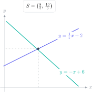

A pair of simultaneous equations is not asking you to solve two unrelated equations. It asks for values that make **both equations true at the same time**. That idea connects elimination, substitution, graphs and contextual problems: each method finds a common intersection.

> **Direct answer.** Use elimination when coefficients can be matched easily, substitution when one variable is already isolated and a graph when the intersection must be interpreted. Always test the solution in both original equations.

## Question 1: direct elimination

Solve:

$$
2x+y=11,qquad 3x-y=9.
$$

The coefficients of $y$ are opposites. Add the equations:

$$
5x=20\Rightarrow x=4.
$$

Substitute into the first equation:

$$
2(4)+y=11\Rightarrow y=3.
$$

Check in the second equation: $3(4)-3=9$. The solution is $(4,3)$.

## Question 2: matching coefficients

Solve:

$$
3x+2y=16,qquad 5x-3y=7.
$$

The lowest common multiple of 2 and 3 is 6. Multiply the first equation by 3 and the second by 2:

$$
9x+6y=48,qquad 10x-6y=14.
$$

Adding gives:

$$
19x=62\Rightarrow x=\frac{62}{19}.
$$

Substitute without rounding:

$$
3\left(\frac{62}{19}\right)+2y=16
\Rightarrow 2y=\frac{118}{19}
\Rightarrow y=\frac{59}{19}.
$$

Fractions do not mean that the method failed. Early rounding would make the final check less accurate.

## Question 3: substitution

Solve:

$$
y=2x+1,qquad 4x+y=16.
$$

The first equation already gives $y$. Substitute it into the second:

$$
4x+(2x+1)=16,
$$

$$
6x=15\Rightarrow x=2.5.
$$

Then:

$$
y=2(2.5)+1=6.
$$

The solution $(2.5,6)$ satisfies $4(2.5)+6=16$.

## Question 4: ticket problem

An event sells 30 tickets. Adult tickets cost €8 and junior tickets cost €5. The total income is €201. How many of each ticket were sold?

Let $a$ be adult tickets and $j$ be junior tickets:

$$
a+j=30,qquad 8a+5j=201.
$$

Multiply the first equation by 5:

$$
5a+5j=150.
$$

Subtract this from the income equation:

$$
3a=51\Rightarrow a=17.
$$

Therefore, $j=30-17=13$. The contextual check is €$17(8)+13(5)=201$. State both quantities in the final answer.

## Question 5: linear-quadratic system

Find the intersection points of:

$$
y=x+2,qquad y=x^2-4.
$$

Both expressions equal $y$, so equate them:

$$
x+2=x^2-4,
$$

$$
x^2-x-6=0,
$$

$$
(x-3)(x+2)=0.
$$

Thus, $x=3$ or $x=-2$. Find each $y$-coordinate from the line:

$$
x=3\Rightarrow y=5,qquad x=-2\Rightarrow y=0.
$$

The two intersections are $(3,5)$ and $(-2,0)$. A linear-quadratic system may have two, one or no real solutions.

## Choosing the method

- An isolated variable: substitution.
- Equal or opposite coefficients: elimination.
- Visual interpretation or an estimate: graph.
- A line and a curve: equate expressions and solve the resulting equation.

## Errors that lose marks

- Multiplying only one term in an equation.
- Adding equations without controlling signs.
- Finding $x$ but not $y$.
- Failing to define variables in context.
- Rounding a fraction too early.
- Checking only one equation.

The Método Nebula virtual campus brings together GCSE algebra, guided examples, graded practice and worked papers. Use the contact button to request a bilingual route that identifies whether the difficulty lies in modelling, elimination or checking and then selects the next practice set.
