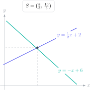

Un sistema de ecuaciones no pide resolver dos ecuaciones por separado. Pide encontrar los valores que hacen verdaderas **ambas a la vez**. Esa idea conecta eliminación, sustitución, gráficas y problemas de contexto: todos buscan una intersección común.

> **Respuesta directa.** Utiliza eliminación cuando los coeficientes pueden igualarse con facilidad, sustitución cuando una variable ya está aislada y representación gráfica cuando se pide interpretar la intersección. Comprueba siempre la solución en las dos ecuaciones.

## Ejercicio 1: eliminación directa

Resuelve:

$$
2x+y=11,qquad 3x-y=9.
$$

Los coeficientes de $y$ son opuestos. Sumamos las ecuaciones:

$$
5x=20\Rightarrow x=4.
$$

Sustituimos en la primera:

$$
2(4)+y=11\Rightarrow y=3.
$$

Comprobación en la segunda: $3(4)-3=9$. La solución es $(4,3)$.

## Ejercicio 2: igualar coeficientes

Resuelve:

$$
3x+2y=16,qquad 5x-3y=7.
$$

El mínimo común múltiplo de 2 y 3 es 6. Multiplicamos la primera ecuación por 3 y la segunda por 2:

$$
9x+6y=48,qquad 10x-6y=14.
$$

Al sumar:

$$
19x=62\Rightarrow x=\frac{62}{19}.
$$

Sustituimos sin redondear:

$$
3\left(\frac{62}{19}\right)+2y=16
\Rightarrow 2y=\frac{118}{19}
\Rightarrow y=\frac{59}{19}.
$$

Las fracciones no indican que el método haya fallado. Redondear en mitad del ejercicio haría menos precisa la comprobación.

## Ejercicio 3: sustitución

Resuelve:

$$
y=2x+1,qquad 4x+y=16.
$$

La primera ecuación ya proporciona $y$. La sustituimos en la segunda:

$$
4x+(2x+1)=16,
$$

$$
6x=15\Rightarrow x=2.5.
$$

Entonces:

$$
y=2(2.5)+1=6.
$$

La solución $(2.5,6)$ satisface $4(2.5)+6=16$.

## Ejercicio 4: problema con entradas

En un evento se venden 30 entradas. Las entradas de adulto cuestan 8 € y las juveniles 5 €. La recaudación es 201 €. ¿Cuántas se vendieron de cada tipo?

Definimos $a$ como entradas de adulto y $j$ como juveniles:

$$
a+j=30,qquad 8a+5j=201.
$$

Multiplicamos la primera por 5:

$$
5a+5j=150.
$$

Restamos esta ecuación de la de ingresos:

$$
3a=51\Rightarrow a=17.
$$

Por tanto, $j=30-17=13$. La comprobación contextual es $17(8)+13(5)=201$ €. La respuesta debe incluir las dos cantidades, no solo el valor de $a$.

## Ejercicio 5: sistema lineal-cuadrático

Encuentra los puntos de corte de:

$$
y=x+2,qquad y=x^2-4.
$$

Como ambas expresiones son iguales a $y$, las igualamos:

$$
x+2=x^2-4,
$$

$$
x^2-x-6=0,
$$

$$
(x-3)(x+2)=0.
$$

Así, $x=3$ o $x=-2$. Calculamos cada coordenada $y$ con la recta:

$$
x=3\Rightarrow y=5,qquad x=-2\Rightarrow y=0.
$$

Hay dos intersecciones: $(3,5)$ y $(-2,0)$. En estos sistemas es frecuente encontrar dos, una o ninguna solución real.

## Cómo elegir el método

- Variable aislada: sustitución.
- Coeficientes iguales u opuestos: eliminación.
- Interpretación visual o aproximación: gráfica.
- Recta y curva: iguala expresiones y resuelve la ecuación resultante.

## Errores que cuestan puntos

- Multiplicar solo un término de una ecuación.
- Sumar ecuaciones sin controlar los signos.
- Hallar $x$ y olvidar calcular $y$.
- No definir las variables de un problema.
- Redondear una fracción demasiado pronto.
- Comprobar en una sola ecuación.

El campus virtual de Método Nebula reúne álgebra GCSE, ejemplos guiados, ejercicios graduados y exámenes resueltos. El botón de contacto permite solicitar una ruta bilingüe que detecta si el bloqueo está en el planteamiento, la eliminación o la comprobación y propone la práctica siguiente.
