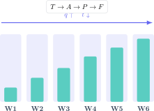

A GCSE mock should not be a surprise or a verdict on your ability. It is an experiment: it reproduces part of the exam, reveals where marks are lost and gives you time to repair the revision system before the final papers. Six weeks are enough when each week has a different purpose.

> **Direct answer.** Start with a diagnostic paper, rank topics by risk, combine active recall with questions and gradually increase timed work. The final week should confirm the method rather than introduce a large amount of new content.

## Week 1: measure before planning

Complete one Maths set and one Science set without notes. Mark them with the official scheme and assign each topic a mastery value $d$ between 0 and 1 and an estimated exam frequency $f$. A simple priority measure is:

$$
P=(1-d)f.
$$

A frequent, weak topic receives a high priority. This prevents hours being spent on an interesting low-frequency detail while equations, units or proportion continue to cost marks.

## Week 2: rebuild the foundations

Use short sessions for ideas that support several topics. In Maths: fractions, algebra, ratio, graphs and geometry. In Physics: units, rearranging equations, energy, forces and circuits. In Chemistry: particles, bonding, moles, equations and chemical changes.

Every session must finish with closed-book questions. Reading creates familiarity; retrieval without the page demonstrates learning. If you cannot explain why an equation applies, you do not yet control it.

## Week 3: mix topics without losing rigour

Begin interleaving questions. Moving between algebra, geometry and statistics forces you to identify the model before calculating. In Science, mix data interpretation, explanations and calculations.

Keep an error log with three fields:

- evidence: the exact line where the answer went wrong;
- cause: concept, formula choice, algebra, unit or reading;
- repair: one equivalent question to repeat within 48 hours.

## Week 4: add time and decisions

Complete 30–45 minute sets. Before starting, estimate how many marks you will attempt. Then calculate accuracy and coverage:

$$
\text{accuracy}=\frac{\text{marks earned}}{\text{marks attempted}},\qquad
\text{coverage}=\frac{\text{marks attempted}}{\text{marks available}}.
$$

High accuracy with low coverage suggests slow working or avoidance. High coverage with low accuracy suggests rushed decisions. Adjust the next week around the weaker indicator.

## Week 5: practise the real format

Complete at least one paper per subject under the correct conditions: official time, permitted calculator, formula sheet and no notes. In longer questions, underline the command word: calculate, compare, evaluate or explain.

For a scientific explanation, build a causal chain: principle, change, consequence and link to the question. In Maths, show essential transformations and finish with a contextual conclusion.

## Week 6: simulate, mark and reduce

Sit the final mock several days before the school exam. Marking it matters more than completing another paper. Group recurring errors and create a one-page check list.

During the final 24 hours, review that page, essential equations and two representative examples. A long late-night session usually reduces the attention needed to read data and control signs.

## A sustainable weekly pattern

Four 50-minute sessions can beat one Sunday marathon. A useful structure is 10 minutes of closed-book recall, 30 minutes of problems and 10 minutes of marking. Add one timed session at the weekend.

The Método Nebula virtual campus organises GCSE Maths, Physics and Chemistry into connected routes with visual theory, graded practice, mock papers and fully reasoned solutions. Use the contact button to request a diagnostic and turn these six weeks into a calendar matched to your subjects, tier and mock date.
