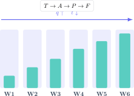

Un simulacro GCSE no debería ser una sorpresa ni una sentencia sobre tu capacidad. Es un experimento: reproduce parte del examen, muestra dónde se pierden puntos y permite corregir el sistema de estudio antes de la convocatoria real. Seis semanas son suficientes si cada una tiene una función distinta.

> **Respuesta directa.** Empieza con una prueba diagnóstica, distribuye los temas por riesgo, combina recuerdo activo con preguntas y aumenta progresivamente la proporción de trabajo cronometrado. La última semana debe confirmar el método, no llenarse de contenido nuevo.

## Semana 1: mide antes de planificar

Haz un bloque de Matemáticas y otro de Ciencias sin consultar apuntes. Corrige con el criterio oficial y asigna a cada tema dos valores: dominio $d$ entre 0 y 1 y frecuencia $f$ estimada en el examen. Una prioridad sencilla es:

$$
P=(1-d)f.
$$

Un tema frecuente y poco dominado obtiene prioridad alta. Esta regla evita dedicar horas a un apartado interesante pero poco rentable mientras continúan fallando ecuaciones, unidades o proporcionalidad.

## Semana 2: reconstruye los fundamentos

Reserva sesiones breves para conceptos que sostienen varios temas. En Matemáticas: fracciones, álgebra, razón, gráficas y geometría. En Física: unidades, despeje, energía, fuerzas y circuitos. En Química: partículas, enlace, moles, ecuaciones y cambios químicos.

Cada sesión debe terminar con preguntas cerradas. Leer una explicación produce familiaridad; resolver sin verla demuestra recuperación. Si no puedes explicar por qué aplicas una ecuación, todavía no la controlas.

## Semana 3: mezcla temas sin perder rigor

Empieza a combinar preguntas. Alternar álgebra, geometría y estadística obliga a reconocer el modelo antes de calcular. En Ciencias, combina interpretación de datos, explicación y cálculo.

Utiliza una hoja de errores con tres campos:

- evidencia: la línea exacta donde aparece el fallo;
- causa: concepto, selección de fórmula, álgebra, unidad o lectura;
- reparación: una pregunta equivalente que repetirás dentro de 48 horas.

## Semana 4: introduce tiempo y decisiones

Realiza bloques de 30–45 minutos. Antes de empezar, estima cuántos puntos intentarás. Después calcula tanto la precisión como la cobertura:

$$
\text{precisión}=\frac{\text{puntos logrados}}{\text{puntos intentados}},\qquad
\text{cobertura}=\frac{\text{puntos intentados}}{\text{puntos disponibles}}.
$$

Una precisión alta con cobertura baja indica lentitud o evitación. Una cobertura alta con precisión baja indica respuestas precipitadas. El plan debe corregir el indicador más débil.

## Semana 5: practica el formato real

Completa al menos un examen por asignatura con las condiciones correctas: tiempo, calculadora permitida, tabla de fórmulas y ausencia de ayudas. En preguntas largas, subraya el verbo: calcular, comparar, evaluar o explicar.

En una explicación científica usa una cadena causal: principio, cambio, consecuencia y vínculo con la pregunta. En Matemáticas, conserva las transformaciones esenciales y concluye en el contexto.

## Semana 6: simula, corrige y reduce

Haz el último simulacro con varios días de margen. La corrección importa más que completar otro examen. Agrupa los errores recurrentes y prepara una lista de comprobación de una página.

En las últimas 24 horas revisa esa lista, fórmulas esenciales y dos ejemplos representativos. Una sesión nocturna extensa suele empeorar la atención que necesitas para leer datos y evitar signos incorrectos.

## Un horario sostenible

Cuatro sesiones semanales de 50 minutos pueden superar a una maratón dominical. Una estructura útil es: 10 minutos de recuperación sin apuntes, 30 de problemas y 10 de corrección. Añade una sesión cronometrada el fin de semana.

El campus virtual de Método Nebula organiza Matemáticas, Física y Química GCSE en rutas conectadas, con teoría visual, práctica graduada, simulacros y soluciones justificadas. Desde el botón de contacto puedes solicitar un diagnóstico para transformar estas seis semanas en un calendario ajustado a tus asignaturas, nivel y fecha de simulacro.
