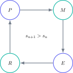

A past paper is a limited resource. If you read it beside the solutions, you may recognise the method, but that paper can no longer measure what you could do independently. Its value is not the number of completed papers; it is the verifiable learning extracted from every attempt.

> **Direct answer.** Work in four stages: attempt without help, mark with evidence, classify the error and repeat an equivalent question. Keep some papers untouched for full mocks and use the others for topic sets and individual questions.

## Before starting: give each paper a purpose

Divide the available papers into three groups:

- diagnostic: one per subject to measure the starting point;
- training: papers that can be separated into topics;
- simulation: at least two papers that remain untouched.

This prevents you from seeing every question before the final measurement. Once an answer is remembered, the score is no longer comparable with the real exam.

## Stage 1: attempt without turning it into a guess

Read the command, identify the data and write a plan before checking anything. If you cannot continue, record the exact point where you became stuck. That location is useful evidence: the missing step may be a concept, model selection or algebraic technique.

For calculations, show equation, substitution, operation and unit. For explanations, construct a causal chain. For evaluation questions, use the supplied data and balance at least one relevant advantage against one limitation.

## Stage 2: read the mark scheme correctly

The mark scheme is not an answer to copy. It describes the evidence that earns credit. Distinguish between:

- method marks, awarded for a valid route;
- accuracy marks, dependent on a calculation or final term;
- independent marks, available despite an earlier mistake;
- alternative answers, showing that more than one argument may be valid.

Mark your answer line by line. If you are unsure whether a sentence demonstrates the idea, treat it as insufficient and rewrite it with an explicit relationship.

## Stage 3: turn every loss into a category

A useful classification has five causes: knowledge, method, algebra or calculation, reading and communication. Then calculate the frequency:

$$
f_k=\frac{n_k}{\sum_j n_j},
$$

where $n_k$ is the number of errors in category $k$. If reading and communication dominate, more content notes will not repair the main problem.

## Stage 4: reattempt until the error closes

Understanding a solution while it is visible is not enough. Close the scheme, wait several hours and solve the question again. Then find a question with the same structure and different data.

An error is repaired only when you can:

1. identify the question type;
2. select the principle independently;
3. complete the method;
4. explain why the answer is reasonable.

## Measuring genuine improvement

Record the score, time, unattempted questions and repeated errors. One simple indicator is:

$$
I=\frac{\text{marks}}{\text{time in minutes}}.
$$

The aim is not to maximise $I$ by rushing, but to increase it while preserving accuracy. If the score rises only because questions look familiar, verify it on one of the reserved papers.

## When to use a complete paper

Early in revision, topic questions concentrate practice. Nearer the exam, a full paper trains selection, stamina and context switching. Use official time, equipment and breaks, then mark it on the same or following day.

## The rule that prevents wasted papers

Every paper should produce three outputs: a score, a short error list and a repair set. If it produces only a grade, it has measured the problem without changing it.

The Método Nebula virtual campus connects GCSE papers to the relevant theory, graded exercises and solutions that explain where each mark comes from. Use the contact button to access a bilingual route in which every paper generates targeted practice, progress tracking and a clear next step.
