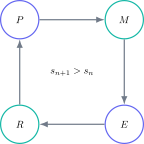

Un examen anterior es un recurso limitado. Si lo lees junto a las soluciones, reconoces el procedimiento pero ya no puedes utilizar ese documento para medir lo que sabías hacer por ti mismo. El valor no está en acumular exámenes terminados, sino en extraer aprendizaje verificable de cada intento.

> **Respuesta directa.** Trabaja en cuatro fases: intenta sin ayuda, corrige con evidencia, clasifica el error y repite una versión equivalente. Reserva algunos exámenes intactos para simulacros completos; utiliza los demás por bloques y preguntas.

## Antes de empezar: asigna una función al documento

Divide los exámenes disponibles en tres grupos:

- diagnóstico: uno por asignatura para medir el punto de partida;
- entrenamiento: varios documentos que podrás separar por temas;
- simulación: al menos dos exámenes que permanecerán intactos.

Esta división evita haber visto todas las preguntas antes de necesitar una medida final. Si conoces el resultado de memoria, la puntuación deja de ser comparable con el examen real.

## Fase 1: intenta sin convertirlo en una adivinanza

Lee la instrucción, identifica los datos y escribe un plan antes de consultar nada. Si no puedes avanzar, registra dónde te bloqueas. Esa localización ya es información: puede faltar el concepto, la selección del modelo o una técnica algebraica.

En preguntas de cálculo, muestra fórmula, sustitución, operación y unidad. En explicaciones, construye una cadena causal. En preguntas de evaluación, utiliza los datos proporcionados y contrapón al menos una ventaja y una limitación relevantes.

## Fase 2: interpreta el criterio de corrección

El criterio no es una respuesta para copiar. Es una descripción de qué evidencia recibe puntos. Distingue:

- puntos de método, que reconocen una estrategia válida;
- puntos de exactitud, que dependen del cálculo o término final;
- puntos independientes, que pueden obtenerse aunque una parte anterior falle;
- respuestas alternativas, que muestran que puede haber más de un desarrollo correcto.

Marca tu respuesta línea por línea. Si dudas si una frase demuestra la idea, considérala insuficiente y reescríbela con una relación explícita.

## Fase 3: convierte cada fallo en una categoría

Una clasificación útil contiene cinco causas: conocimiento, método, álgebra o cálculo, lectura y comunicación. Calcula después la frecuencia:

$$
f_k=\frac{n_k}{\sum_j n_j},
$$

donde $n_k$ es el número de errores de la categoría $k$. Si la mayoría pertenece a lectura y comunicación, estudiar más teoría no solucionará el problema principal.

## Fase 4: repite hasta cerrar el error

No basta con entender la solución cuando está delante. Cierra el criterio, deja pasar unas horas y resuelve otra vez. Después busca una pregunta con la misma estructura y datos diferentes.

Considera reparado un error solo si puedes:

1. identificar el tipo de pregunta;
2. elegir el principio sin ayuda;
3. ejecutar el desarrollo;
4. explicar por qué el resultado es razonable.

## Cómo medir una mejora real

Registra puntuación, tiempo, preguntas no intentadas y errores repetidos. Una medida sencilla es:

$$
I=\frac{\text{puntos}}{\text{tiempo en minutos}}.
$$

El objetivo no es maximizar $I$ apresuradamente, sino elevarlo manteniendo la precisión. Si la nota sube solo porque reconoces preguntas ya vistas, compruébala con uno de los exámenes reservados.

## Cuándo usar un examen completo

Al principio, las preguntas por tema permiten concentrar la práctica. Más cerca del examen, un documento completo entrena selección, resistencia y cambio de contexto. Realízalo con el tiempo, material y pausas oficiales; corrígelo el mismo día o al siguiente.

## La regla que evita desperdiciar exámenes

Cada documento debe producir tres resultados: una puntuación, una lista breve de errores y un conjunto de tareas de reparación. Si solo produce una nota, has medido el problema sin corregirlo.

El campus virtual de Método Nebula integra exámenes GCSE con teoría vinculada, ejercicios graduados y soluciones que explican de dónde sale cada punto. El botón de contacto permite acceder a una ruta bilingüe donde cada examen genera práctica específica, seguimiento y un siguiente paso claro.
