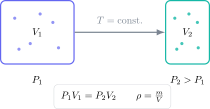

Density and pressure often appear together because each connects a quantity to the space it occupies or the surface on which it acts. The exam challenge is not memorising three equations. It is distinguishing mass, volume, force and area, converting units and explaining what happens when one variable changes.

> **Direct answer.** State the required quantity, convert every value into compatible units and substitute with units shown. For a gas at constant temperature, reducing the volume raises the pressure because particles collide with the container walls more frequently.

## Question 1: density of a block

A block has a mass of $540\ \mathrm g$ and a volume of $200\ \mathrm{cm^3}$. Calculate its density in $\mathrm{g\,cm^{-3}}$ and $\mathrm{kg\,m^{-3}}$.

$$
\rho=\frac{m}{V}=\frac{540}{200}=2.70\ \mathrm{g\,cm^{-3}}.
$$

Since $1\ \mathrm{g\,cm^{-3}}=1000\ \mathrm{kg\,m^{-3}}$:

$$
\rho=2700\ \mathrm{kg\,m^{-3}}.
$$

You can verify the factor of 1000 using $1\ \mathrm g=10^{-3}\ \mathrm{kg}$ and $1\ \mathrm{cm^3}=10^{-6}\ \mathrm{m^3}$.

## Question 2: displacement volume

A stone raises the level in a measuring cylinder from $35\ \mathrm{mL}$ to $62\ \mathrm{mL}$. Its mass is $67.5\ \mathrm g$. Calculate the density.

The object's volume is the change in reading:

$$
V=62-35=27\ \mathrm{mL}=27\ \mathrm{cm^3}.
$$

Therefore:

$$
\rho=\frac{67.5}{27}=2.50\ \mathrm{g\,cm^{-3}}.
$$

Do not use the final $62\ \mathrm{mL}$ reading as the stone's volume.

## Question 3: pressure beneath a box

A box exerts a force of $480\ \mathrm N$ on a base measuring $0.30\ \mathrm m\times0.20\ \mathrm m$. Calculate the pressure.

The area is:

$$
A=0.30(0.20)=0.060\ \mathrm{m^2}.
$$

Hence:

$$
P=\frac{F}{A}=\frac{480}{0.060}=8000\ \mathrm{Pa}.
$$

If the box rests on a face with half the area, the pressure doubles even though its weight is unchanged.

## Question 4: pressure in a liquid

Calculate the pressure increase at a depth of $5.0\ \mathrm m$ in water with density $1000\ \mathrm{kg\,m^{-3}}$. Use $g=9.8\ \mathrm{N\,kg^{-1}}$.

$$
\Delta P=\rho gh,
$$

$$
\Delta P=(1000)(9.8)(5.0)=4.9\times10^4\ \mathrm{Pa}.
$$

This is the additional pressure caused by the water. If absolute pressure is required, include atmospheric pressure:

$$
P_{\text{abs}}=P_{\text{atm}}+\rho gh.
$$

## Question 5: compressing a gas

A gas occupies $120\ \mathrm{cm^3}$ at $100\ \mathrm{kPa}$. It is compressed at constant temperature to $75\ \mathrm{cm^3}$. Calculate the new pressure.

$$
P_1V_1=P_2V_2,
$$

$$
P_2=\frac{P_1V_1}{V_2}=\frac{100(120)}{75}=160\ \mathrm{kPa}.
$$

The pressure rises because the same number of particles occupies less volume. They travel a shorter distance between walls, increasing the collision frequency per unit area.

## A particle explanation that earns marks

Gas pressure results from particle collisions with the walls. At constant temperature, mean kinetic energy is unchanged. When volume falls, collisions become more frequent and the mean force per unit area rises.

Heating a gas in a rigid container makes the particles move faster. Each collision produces a larger momentum change and collisions occur more frequently, so pressure rises even though volume is fixed.

## Common errors

- Confusing mass with weight.
- Using a length when area is required.
- Mixing cubic centimetres and cubic metres.
- Using the final cylinder reading instead of the displacement.
- Adding atmospheric pressure when only the increase is required, or omitting it for absolute pressure.
- Applying $P_1V_1=P_2V_2$ when temperature changes without justification.

The Método Nebula virtual campus connects particles, density, forces, pressure and gas models through visual theory, graded exercises and worked GCSE questions. Use the contact button to request a bilingual route that trains conversions, calculations and particle explanations against exam criteria.
