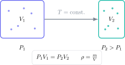

Densidad y presión suelen aparecer juntas porque ambas relacionan una cantidad con el espacio que ocupa o la superficie sobre la que actúa. El reto del examen no es memorizar tres fórmulas, sino distinguir masa, volumen, fuerza y área, convertir unidades y justificar qué ocurre cuando cambia una variable.

> **Respuesta directa.** Escribe la magnitud buscada, pasa todos los datos al SI y sustituye con unidades. Para gases a temperatura constante, una reducción de volumen produce un aumento de presión porque las partículas chocan con las paredes con mayor frecuencia.

## Ejercicio 1: densidad de un bloque

Un bloque tiene masa $540\ \mathrm g$ y volumen $200\ \mathrm{cm^3}$. Calcula su densidad en $\mathrm{g\,cm^{-3}}$ y en $\mathrm{kg\,m^{-3}}$.

$$
\rho=\frac{m}{V}=\frac{540}{200}=2.70\ \mathrm{g\,cm^{-3}}.
$$

Como $1\ \mathrm{g\,cm^{-3}}=1000\ \mathrm{kg\,m^{-3}}$:

$$
\rho=2700\ \mathrm{kg\,m^{-3}}.
$$

El factor 1000 puede comprobarse convirtiendo por separado $1\ \mathrm g=10^{-3}\ \mathrm{kg}$ y $1\ \mathrm{cm^3}=10^{-6}\ \mathrm{m^3}$.

## Ejercicio 2: volumen por desplazamiento

Una piedra eleva el nivel de una probeta de $35\ \mathrm{mL}$ a $62\ \mathrm{mL}$. Su masa es $67.5\ \mathrm g$. Calcula la densidad.

El volumen del objeto es el cambio de lectura:

$$
V=62-35=27\ \mathrm{mL}=27\ \mathrm{cm^3}.
$$

Por tanto:

$$
\rho=\frac{67.5}{27}=2.50\ \mathrm{g\,cm^{-3}}.
$$

No debe utilizarse la lectura final de $62\ \mathrm{mL}$ como volumen de la piedra.

## Ejercicio 3: presión bajo una caja

Una caja ejerce una fuerza de $480\ \mathrm N$ sobre una base de $0.30\ \mathrm m\times0.20\ \mathrm m$. Calcula la presión.

El área es:

$$
A=0.30(0.20)=0.060\ \mathrm{m^2}.
$$

Entonces:

$$
P=\frac{F}{A}=\frac{480}{0.060}=8000\ \mathrm{Pa}.
$$

Si la caja se apoya sobre una cara con la mitad de área, la presión se duplica aunque el peso no cambie.

## Ejercicio 4: presión en un líquido

Calcula el aumento de presión a $5.0\ \mathrm m$ de profundidad en agua de densidad $1000\ \mathrm{kg\,m^{-3}}$. Utiliza $g=9.8\ \mathrm{N\,kg^{-1}}$.

$$
\Delta P=\rho gh,
$$

$$
\Delta P=(1000)(9.8)(5.0)=4.9\times10^4\ \mathrm{Pa}.
$$

Esta es la presión adicional debida al agua. Si piden presión absoluta, debe sumarse la presión atmosférica:

$$
P_{\text{abs}}=P_{\text{atm}}+\rho gh.
$$

## Ejercicio 5: comprimir un gas

Un gas ocupa $120\ \mathrm{cm^3}$ a $100\ \mathrm{kPa}$. Se comprime a temperatura constante hasta $75\ \mathrm{cm^3}$. Calcula la nueva presión.

$$
P_1V_1=P_2V_2,
$$

$$
P_2=\frac{P_1V_1}{V_2}=\frac{100(120)}{75}=160\ \mathrm{kPa}.
$$

La presión aumenta porque el mismo número de partículas ocupa menos volumen. Recorren menos distancia entre paredes y aumenta la frecuencia de colisiones por unidad de área.

## Explicación microscópica que obtiene puntos

La presión de un gas surge de los choques de las partículas contra las paredes. A temperatura constante, la energía cinética media no cambia. Si el volumen disminuye, las colisiones son más frecuentes y la fuerza media por unidad de área aumenta.

Al calentar un gas en un recipiente rígido, las partículas se mueven más deprisa, cada choque cambia más momento y también aumenta la frecuencia. Por eso crece la presión aunque el volumen permanezca fijo.

## Errores frecuentes

- Confundir masa con peso.
- Utilizar longitud donde se necesita área.
- Mezclar centímetros cúbicos y metros cúbicos.
- Calcular desplazamiento con la lectura final únicamente.
- Sumar presión atmosférica cuando solo piden el incremento, o no sumarla cuando piden presión absoluta.
- Aplicar $P_1V_1=P_2V_2$ si cambia la temperatura sin justificarlo.

El campus virtual de Método Nebula conecta partículas, densidad, fuerzas, presión y modelos de gases con teoría visual, ejercicios graduados y preguntas GCSE resueltas. Desde el botón de contacto puedes solicitar una ruta bilingüe que entrena conversiones, cálculos y explicaciones microscópicas con criterios de examen.
