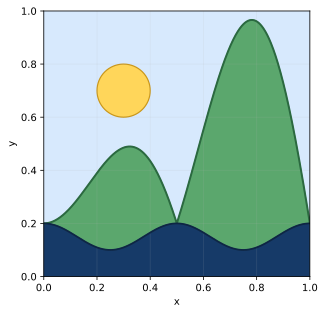

Este examen resuelto conserva el enunciado y desarrolla cada apartado. Úsalo primero a contrarreloj y compáralo después con el razonamiento, no solo con el resultado final.

**Convocatoria:** ordinaria. **Examen:** P1, P2 y P3 obligatorias; una opción de P4 y otra de P5.

## Ejercicio 1 · Caja de volumen máximo

### Enunciado

Tenemos una cartulina rectangular de 20 cm por 30 cm. Recortamos un cuadrado idéntico en cada esquina y doblamos los lados que quedan para fabricar una caja sin tapa. ¿Cuánto debe medir el lado de los cuadrados recortados para que la caja tenga el mayor volumen posible?

### Solución

Sea $x$ el lado de cada recorte. La caja tendrá altura $x$, longitud $30-2x$ y anchura $20-2x$. Su volumen es

$$V(x)=x(30-2x)(20-2x),\qquad0\le x\le10.$$

Desarrollamos y derivamos:

$$\begin{aligned}
V(x)&=4x^3-100x^2+600x,\\
V'(x)&=12x^2-200x+600.
\end{aligned}$$

Igualamos la derivada a cero y dividimos entre cuatro:

$$3x^2-50x+150=0\ \Longrightarrow\ x=\frac{50\pm10\sqrt7}{6}.$$

Las dos raíces son aproximadamente 3,92 y 12,74. La segunda queda fuera del dominio. Nos quedamos con

$$x=\frac{25-5\sqrt7}{3}.$$

Comprobamos que es un máximo mediante la segunda derivada, $V''(x)=24x-200$, que toma un valor negativo en la raíz válida. Por tanto, el recorte óptimo mide

$$\boxed{x=\frac{25-5\sqrt7}{3}\approx3{,}92\ \text{cm}}.$$

## Ejercicio 2 · Propiedades de determinantes

### Enunciado

Encuentra todos los valores reales de $r$ y $t$ con los que $\det A+\det B=4$, donde

$$A=\begin{pmatrix}t&t&t\\t&3+t&t-3\\2&-1&5\end{pmatrix},\qquad
B=\begin{pmatrix}1+r&r&3r\\2&-1&1\\r&r&3r\end{pmatrix}.$$

### Solución

En $A$, restamos la primera columna a la segunda y la tercera; después sumamos la segunda a la tercera. Son operaciones que no alteran el determinante y permiten obtener una columna nula. Por eso,

$$\boxed{\det A=0}\quad\text{para cualquier }t.$$

En $B$, restamos la primera fila a la tercera y sumamos la segunda columna a la tercera. Queda una fila con un único elemento no nulo y se obtiene

$$\boxed{\det B=-4r}.$$

La condición pedida es entonces

$$0-4r=4\ \Longrightarrow\ \boxed{r=-1}.$$

**Respuesta:** $r=-1$ y $t$ puede ser cualquier número real.

## Ejercicio 3 · Perpendicular común a dos rectas

### Enunciado

Busca la ecuación continua de una recta que corte perpendicularmente a las dos rectas siguientes:

$$r:\frac{x}{1}=\frac{y+3}{1}=\frac{z-2}{-2},$$

$$s:\begin{cases}x=-4+3\lambda,\\y=1+\lambda,\\z=-1+2\lambda,\end{cases}\qquad\lambda\in\mathbb R.$$

### Solución

Tomamos puntos y direcciones:

$$P_r=(0,-3,2),\quad u=(1,1,-2),\qquad Q_s=(-4,1,-1),\quad v=(3,1,2).$$

Como los vectores directores no son proporcionales, las rectas no son paralelas. Además, el producto mixto de $u$, $v$ y $Q_s-P_r=(-4,4,-3)$ es distinto de cero: las rectas se cruzan, así que buscamos su **perpendicular común**.

La dirección que es perpendicular a las dos es su producto vectorial:

$$u\times v=(4,-8,-2)=2(2,-4,-1).$$

Tomamos $w=(2,-4,-1)$. Para localizar un punto de la perpendicular común, construimos el plano que contiene $r$ y tiene las direcciones $u$ y $w$:

$$\begin{vmatrix}x&y+3&z-2\\1&1&-2\\2&-4&-1\end{vmatrix}=0
\ \Longrightarrow\ 3x+y+2z-1=0.$$

Intersecamos este plano con $s$. Al sustituir $(-4+3\lambda,1+\lambda,-1+2\lambda)$:

$$3(-4+3\lambda)+(1+\lambda)+2(-1+2\lambda)-1=0
\ \Longrightarrow\ 14\lambda=14.$$

Para $\lambda=1$, el punto es $R=(-1,2,1)$. La recta pedida pasa por $R$ y tiene dirección $w$, por lo que

$$\boxed{t:\frac{x+1}{2}=\frac{y-2}{-4}=\frac{z-1}{-1}}.$$

## Ejercicio 4.1 · Preguntas tipo test

### Enunciado

En un test hay 10 preguntas con 4 opciones cada una y solo una respuesta correcta. Si contestamos al azar, calcula:

**i)** La probabilidad de equivocarnos en todas.

**ii)** La probabilidad de acertar exactamente 7.

**iii)** La probabilidad de aprobar, sabiendo que hacen falta al menos 7 aciertos.

### Solución

Sea $X$ el número de errores. Como la probabilidad de fallar es $3/4$, tenemos $X\sim B(10,0{,}75)$.

**i)** Fallar todas equivale a $X=10$:

$$P(X=10)=(0{,}75)^{10}\approx\boxed{0{,}0563}.$$

**ii)** Acertar 7 significa fallar 3:

$$P(X=3)=\binom{10}{3}(0{,}75)^3(0{,}25)^7\approx\boxed{0{,}0031}.$$

**iii)** Para aprobar podemos fallar 0, 1, 2 o 3 preguntas:

$$\begin{aligned}
P(\text{aprobar})&=\sum_{j=0}^{3}\binom{10}{j}(0{,}75)^j(0{,}25)^{10-j}\\
&\approx\boxed{0{,}0035}.
\end{aligned}$$

## Ejercicio 4.2 · Idiomas y combinatoria

### Enunciado

En una reunión sobre el histórico Tributo de las Tres Vacas participan 5 personas de Bearne, 5 del valle del Roncal y 2 de Sola. Los bearneses hablan bearnés entre sí; los roncaleses, euskera; y los dos suletinos hablan euskera con los roncaleses y entre sí, pero también pueden comunicarse en bearnés con los bearneses.

**i)** Si elegimos dos personas al azar entre las 12, ¿qué probabilidad hay de que puedan hablar euskera entre ellas?

**ii)** ¿Y de que puedan hablar bearnés entre ellas?

**iii)** Si escogemos tres de los 5 bearneses y 5 roncaleses para sentarlos a una mesa, ¿qué probabilidad hay de que no compartan todos el mismo idioma?

### Solución

**i)** Son 7 las personas que pueden hablar euskera entre ellas (5 roncaleses y 2 suletinos). Entre las $\binom{12}{2}=66$ parejas posibles, hay $\binom72=21$ favorables:

$$P(\text{euskera})=\frac{21}{66}=\boxed{\frac7{22}\approx0{,}3182}.$$

**ii)** Se pueden comunicar en bearnés las parejas de dos bearneses, $\binom52=10$, y las de un bearnés con un suletino, $5\cdot2=10$. En total son 20 parejas:

$$P(\text{bearnés})=\frac{20}{66}=\boxed{\frac{10}{33}\approx0{,}3030}.$$

**iii)** Entre los 10 asistentes hay $\binom{10}{3}=120$ ternas. En una terna todos comparten idioma solo cuando las 3 personas son roncalesas o las 3 son bearnesas. Las posibilidades son $2\binom53=20$. Usamos el suceso complementario:

$$P(\text{no comparten todos el idioma})
=1-\frac{20}{120}=\boxed{\frac56\approx0{,}8333}.$$

## Ejercicio 5.1 · Un paisaje dibujado con funciones

### Enunciado

Un artista representa un paisaje cuadrado de lado 1 mediante tres curvas: una línea para el mar, otra para el contorno de las montañas y una circunferencia que forma el sol.

$$y=0{,}15+\frac1{20}\cos(4\pi x),$$

$$(x-0{,}3)^2+(y-0{,}7)^2=\frac1{100},$$

$$y=0{,}2+x\,|\sin(2\pi x)|.$$

Asocia cada ecuación con el mar, las montañas o el sol, y calcula qué porcentaje del cuadro corresponde a la montaña visible sobre el mar.

### Solución

La ecuación con cuadrados describe la **circunferencia del sol**, de centro $(0{,}3,0{,}7)$ y radio $0{,}1$. La función coseno de pequeña amplitud representa el **mar** y la función con valor absoluto del seno dibuja las **montañas**.

Para obtener el área visible de montaña restamos la altura del mar a la de la montaña e integramos entre $x=0$ y $x=1$:

$$A=\int_0^1\left[0{,}05+x|\sin(2\pi x)|-\frac1{20}\cos(4\pi x)\right]dx.$$

Para quitar el valor absoluto, partimos en $x=1/2$. En $[0,1/2]$ el seno es positivo y en $[1/2,1]$ es negativo:

$$\begin{aligned}
A={}&\int_0^{1/2}\left(0{,}05+x\sin(2\pi x)-\frac1{20}\cos(4\pi x)\right)dx\\
&+\int_{1/2}^{1}\left(0{,}05-x\sin(2\pi x)-\frac1{20}\cos(4\pi x)\right)dx.
\end{aligned}$$

Integramos por partes el término $x\sin(2\pi x)$:

$$\int x\sin(2\pi x)\,dx=-\frac{x\cos(2\pi x)}{2\pi}+\frac{\sin(2\pi x)}{4\pi^2}+C.$$

Al evaluar ambos tramos, los términos oscilatorios del mar se cancelan y obtenemos

$$A=0{,}05+\frac1\pi\approx0{,}3683.$$

Como el cuadro ocupa una unidad cuadrada, el porcentaje de montaña visible es

$$\boxed{100A\approx36{,}83\%}.$$

## Ejercicio 5.2 · Teorema del valor medio

### Enunciado

Para la función

$$f(x)=\log_2\left[x\left(\sin(\pi x)+2\right)\right],$$

demuestra que existe al menos un punto $c\in[2,4]$ para el que $f'(c)=1/2$.

### Solución

En el intervalo $[2,4]$ se cumple $x>0$ y $\sin(\pi x)+2\ge1$. El argumento del logaritmo es positivo, por lo que $f$ es continua en el intervalo y derivable en su interior.

Se puede aplicar el **teorema del valor medio**. Calculamos los extremos:

$$f(2)=\log_2[2(0+2)]=\log_2 4=2,$$

$$f(4)=\log_2[4(0+2)]=\log_2 8=3.$$

El teorema asegura la existencia de algún $c\in(2,4)$ tal que

$$f'(c)=\frac{f(4)-f(2)}{4-2}=\frac{3-2}{2}=\boxed{\frac12}.$$

## Cómo usar este examen para preparar la PAU

Haz una primera vuelta sin consultar la solución. Al corregir, señala el primer paso que no supiste justificar y repítelo al día siguiente. Así conviertes un modelo de examen en una lista concreta de técnicas que debes entrenar.

Si quieres trabajar estos bloques con una ruta de práctica, explicaciones y seguimiento, tienes el [Campus de Método Nebula](/campus/).

