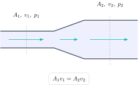

Los ejercicios de fluidos suelen mezclar geometría, conservación de masa y energía. La forma de no perderse es separar las dos leyes principales. La ecuación de continuidad relaciona áreas y velocidades; Bernoulli relaciona presión, velocidad y altura.

Para un fluido incompresible en régimen estacionario,

$$
A_1v_1=A_2v_2=Q,
$$

donde $Q$ es el caudal volumétrico. Si el tubo se estrecha, la velocidad aumenta: no es una intuición opcional, es la conservación del volumen que atraviesa cada sección por segundo.

## Cuándo puede usarse Bernoulli

Entre dos puntos de una misma línea de corriente, para un fluido ideal, incompresible y sin pérdidas, se cumple

$$
p_1+\frac12\rho v_1^2+\rho gz_1
=p_2+\frac12\rho v_2^2+\rho gz_2.
$$

La ecuación no incluye mágicamente cualquier situación real. En bombas, turbulencia o tubos largos con rozamiento se necesita un modelo que incluya aportes y pérdidas de energía.

## Ejercicio resuelto 1: velocidad al estrecharse un conducto

En una tubería horizontal, el diámetro pasa de $8,0\,\mathrm{cm}$ a $4,0\,\mathrm{cm}$. Si en la sección ancha $v_1=1,5\,\mathrm{m/s}$, calcula $v_2$.

Como el área es proporcional al cuadrado del diámetro,

$$
\frac{A_1}{A_2}=\left(\frac{d_1}{d_2}\right)^2
=\left(\frac{8}{4}\right)^2=4.
$$

De continuidad,

$$
v_2=\frac{A_1}{A_2}v_1=4(1,5)=6,0\,\mathrm{m/s}.
$$

Duplicar el diámetro no duplica el área: la cuadruplica. Este es uno de los errores numéricos más frecuentes.

## Ejercicio resuelto 2: presión en un Venturi horizontal

Por un tubo horizontal circula agua ($\rho=1000\,\mathrm{kg/m^3}$). En la zona ancha $v_1=2,0\,\mathrm{m/s}$ y $p_1=180\,\mathrm{kPa}$; en el estrechamiento la velocidad es $v_2=5,0\,\mathrm{m/s}$. Como $z_1=z_2$, Bernoulli queda

$$
p_1+\frac12\rho v_1^2=p_2+\frac12\rho v_2^2.
$$

Despejamos:

$$
p_2=p_1+\frac12\rho(v_1^2-v_2^2).
$$

Sustituyendo en pascales,

$$
p_2=180000+500(4-25)=169500\,\mathrm{Pa}=169,5\,\mathrm{kPa}.
$$

La presión baja en la zona rápida. No porque “la velocidad chupe”, sino porque la energía por unidad de volumen se redistribuye manteniendo el balance de Bernoulli.

## Ejercicio resuelto 3: salida de un depósito

Un depósito grande está abierto a la atmósfera y su superficie libre se encuentra $h=5,0\,\mathrm{m}$ por encima de un orificio pequeño. Calcula la rapidez de salida despreciando pérdidas. En la superficie y el orificio la presión es atmosférica; además, la velocidad de la superficie es aproximadamente cero. Bernoulli da

$$
\rho gh=\frac12\rho v^2.
$$

Por tanto,

$$
v=\sqrt{2gh}=\sqrt{2(9,81)(5,0)}\approx9,9\,\mathrm{m/s}.
$$

La densidad se cancela: para este modelo ideal, la rapidez de salida depende de la altura, no del tipo de líquido.

## Checklist antes de sustituir datos

- Marca dos secciones concretas, con sus $p$, $v$ y $z$.
- Usa continuidad para relacionar velocidades cuando falte una.
- Escribe Bernoulli en forma simbólica y cancela los términos iguales antes de poner números.
- Trabaja con presión en pascales, áreas en metros cuadrados y altura en metros.
- Pregunta si hay pérdidas o una bomba: si las hay, Bernoulli ideal no es suficiente.

El [campus virtual de Método Nebula](/contacto/) organiza los problemas de Física para Ingeniería por modelo físico, con teoría, ejercicios guiados y exámenes resueltos. Esa práctica te enseña a reconocer cuándo usar continuidad, energía o ambas sin depender de una fórmula aislada.
