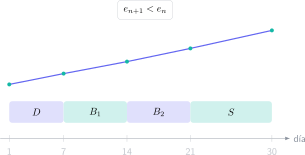

Llegar a la convocatoria extraordinaria no significa volver al primer tema ni repetir exactamente el plan que no funcionó. Ya existen apuntes, horas de clase y al menos una experiencia de examen. El objetivo de los próximos treinta días es convertir esa información en prioridades y puntos.

> **Respuesta directa.** Dedica los primeros días a diagnosticar, dos semanas a reparar los bloques con mayor retorno, una semana a integrar materias y la última a simulacros y revisión. Mide errores y puntuaciones; no midas el progreso por páginas leídas.

## Días 1–3: realiza una autopsia académica, no emocional

Reúne el examen, la corrección si está disponible y tus simulacros. Para cada materia, registra:

- puntos perdidos por contenido;
- puntos perdidos por procedimiento o presentación;
- apartados no intentados;
- tiempo utilizado;
- bloques con mejor y peor rendimiento.

Calcula una prioridad:

$$
P_i=w_i(1-r_i)c_i,
$$

donde $w_i$ es el peso del bloque, $r_i$ tu rendimiento y $c_i$ una medida de cuánto puede mejorar en treinta días. Un bloque importante, débil y reparable debe aparecer primero.

## Días 4–10: recupera fundamentos que desbloquean preguntas

Selecciona dos o tres cuellos de botella por materia. En Matemáticas pueden ser álgebra, funciones o probabilidad; en Física, vectores, unidades y conservación; en Química, moles, ajuste y equilibrio.

Cada sesión debe incluir explicación breve, ejemplo guiado, práctica independiente y una pregunta de examen. Si solo relees teoría, no compruebas la transferencia al formato que se evalúa.

Mantén un registro con fecha de repetición. Un error corregido hoy debe reaparecer dentro de 24–48 horas con datos diferentes.

## Días 11–20: bloques de alta rentabilidad

Trabaja por familias de problemas. En lugar de resolver diez ejercicios idénticos, introduce variaciones que obliguen a decidir: función con parámetro, campo en varios puntos, equilibrio tras una perturbación o probabilidad con condición invertida.

Utiliza sesiones de 50 minutos:

1. 10 minutos de recuperación sin apuntes;
2. 30 minutos de problemas;
3. 10 minutos de corrección y registro.

Al final de cada tres días, realiza una prueba de 30–45 minutos mezclando bloques. La mezcla muestra si reconoces el modelo sin que el título del tema te lo indique.

## Días 21–25: integra y controla el tiempo

Comienza exámenes parciales o completos. Planifica minutos por punto y aplica una regla de salida ante bloqueos. Registra precisión y cobertura:

$$
\text{precisión}=\frac{\text{puntos obtenidos}}{\text{puntos intentados}},\qquad
\text{cobertura}=\frac{\text{puntos intentados}}{\text{puntos totales}}.
$$

Si la cobertura es baja, entrena selección y velocidad. Si la precisión es baja, reduce el ritmo y fortalece las comprobaciones.

## Días 26–28: simulacros completos

Reproduce horario, material y duración. No interrumpas para consultar una fórmula. Después corrige con criterios oficiales y elabora una única lista de fallos recurrentes.

No persigas una nota perfecta en cada simulacro. Busca estabilidad: que los errores ya tratados no vuelvan y que puedas completar una proporción creciente del examen.

## Días 29–30: consolida y llega con energía

Revisa fórmulas razonadas, tarjetas de errores y dos ejercicios representativos por materia. No introduzcas un bloque extenso nuevo. Prepara documentación, desplazamiento y material permitido.

Dormir no compite con el estudio: protege memoria de trabajo, lectura y control algebraico. Una última noche desordenada puede devolver errores que ya habías eliminado.

## Qué no repetir de la convocatoria ordinaria

- Un calendario basado solo en horas.
- Resúmenes largos sin recuperación activa.
- Exámenes corregidos sin repetir los fallos.
- Abandonar una materia durante varios días seguidos.
- Dejar los simulacros para la víspera.
- Cambiar continuamente de materiales y método.

## Una convocatoria extraordinaria también puede mejorar el sistema

La ventaja es disponer de evidencia real. Tu examen anterior revela el tipo de presión, las decisiones de tiempo y los contenidos que no se consolidaron. Utiliza esa evidencia para diseñar un plan más pequeño, más medible y más exigente en la práctica.

El campus virtual de Método Nebula reúne teoría, ejercicios graduados, exámenes resueltos y rutas de recuperación para Matemáticas, Física y Química PAU. Desde el botón de contacto puedes enviar tus resultados y recibir una propuesta de 30 días centrada en los bloques que más puntos pueden devolverte, sin reiniciar todo el curso.
