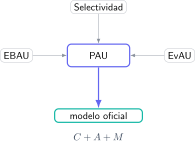

Buscar “examen de Selectividad” sin indicar comunidad, materia ni convocatoria puede llevarte a preparar un formato que no es el tuyo. PAU, EBAU, EvAU y Selectividad se utilizan para hablar de la prueba de acceso, pero **la documentación que manda es la publicada por la administración y la universidad coordinadora de tu territorio**.

> **Respuesta directa.** Selectividad es el nombre popular; PAU es la denominación general actualmente más extendida, mientras que EBAU y EvAU siguen apareciendo en búsquedas y documentos de años anteriores. Para preparar el examen correcto necesitas identificar comunidad, universidad coordinadora, materia, convocatoria y curso.

## Por qué conviven varios nombres

Los cambios normativos y las decisiones autonómicas han producido distintas siglas. En conversaciones, academias y buscadores continúa usándose “Selectividad” porque es inmediatamente reconocible. “EBAU” y “EvAU” fueron habituales en diferentes territorios; “PAU” vuelve a funcionar como término paraguas.

Para el alumno, la cuestión importante no es discutir cuál es la palabra perfecta, sino encontrar el documento vigente. Un examen antiguo puede seguir siendo útil para practicar contenidos, pero no prueba por sí solo la estructura, optatividad o puntuación actual.

## Los tres datos que identifican tu examen

Un modelo queda determinado por:

$$
M=C+A+V,
$$

donde $C$ es la comunidad autónoma, $A$ la asignatura y $V$ la convocatoria o versión. Añade siempre el curso académico. “Matemáticas II PAU Madrid ordinaria 2026” es una búsqueda mucho más precisa que “examen matemáticas selectividad”.

Comprueba además si tu asignatura es Matemáticas II, Matemáticas Aplicadas a las Ciencias Sociales II, Física o Química. Sus estructuras y criterios no son intercambiables.

## Cómo localizar fuentes oficiales

Sigue este orden:

1. Accede al portal de la universidad coordinadora o de educación de tu comunidad.
2. Busca el apartado de acceso a la universidad y la convocatoria correspondiente.
3. Descarga la matriz o estructura, las orientaciones, el modelo y los criterios de corrección.
4. Confirma fecha de actualización y curso.
5. Guarda también los exámenes ordinarios y extraordinarios de años anteriores.

Un documento compartido en redes puede servir como pista, pero debe contrastarse con la publicación institucional. La portada, el dominio y la fecha son parte de la verificación.

## Modelo, orientaciones y criterios no son lo mismo

El modelo muestra una posible disposición de preguntas. Las orientaciones delimitan contenidos, tipos de tareas y condiciones. Los criterios explican qué evidencia recibe puntos. Preparar únicamente el modelo puede hacerte memorizar una distribución circunstancial.

Construye una tabla por bloque:

| Bloque | Tipo de pregunta | Puntuación | Decisiones permitidas | Criterio clave |
|---|---|---:|---|---|
| Análisis | problema o estudio de función | según modelo | revisar optatividad | desarrollo justificado |
| Álgebra | sistema, matrices o geometría | según materia | revisar alternativas | operaciones y conclusión |
| Probabilidad | cálculo e interpretación | según modelo | comprobar datos | sucesos bien definidos |

Adapta las filas al documento real de tu comunidad.

## Cómo utilizar exámenes de otra comunidad

Son útiles para practicar una destreza compartida, como derivadas, estequiometría o campos, pero no deben sustituir la colección local. Antes de incorporarlos, comprueba que el contenido pertenece a tu currículo y que la notación exigida es compatible.

La prioridad puede expresarse así:

$$
P=3L+2A+E,
$$

donde $L$ representa exámenes locales, $A$ exámenes de estructura afín y $E$ ejercicios externos. El mayor peso debe recaer sobre la fuente que reproduce tu evaluación.

## Errores que esta comprobación evita

- Preparar una optatividad que ya no existe.
- Ignorar un bloque porque no apareció en un solo modelo.
- Resolver con un formulario no permitido.
- Practicar Matemáticas II cuando corresponde Ciencias Sociales II.
- Utilizar criterios de un curso anterior como si fueran vigentes.

## Del modelo oficial a un plan de estudio

Una vez identificados los bloques, realiza un diagnóstico con un examen reciente, mide el porcentaje por apartado y asigna horas según frecuencia, debilidad y puntuación. El documento oficial deja de ser un archivo informativo y se convierte en el mapa de la preparación.

El campus virtual de Método Nebula organiza los contenidos de PAU por materia y bloque, conecta cada explicación con ejercicios y exámenes resueltos y permite adaptar el itinerario al modelo oficial de cada alumno. Desde el botón de contacto puedes enviar tu comunidad, asignatura y convocatoria para construir una ruta precisa, sin estudiar a ciegas con materiales de otra prueba.
