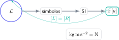

Una colección de fórmulas sin condiciones puede aumentar los errores: invita a elegir por semejanza visual. Un formulario útil de Física PAU debe responder cinco preguntas: qué ley representa, cuándo se aplica, qué significa cada símbolo, qué unidades utiliza y cómo se comprueba el resultado.

> **Respuesta directa.** Organiza el formulario por modelos físicos, no por páginas del libro. En cada ley añade hipótesis, versión vectorial o escalar, unidades SI y una prueba dimensional. Practica reconstruyendo las ecuaciones fundamentales en lugar de memorizar todas las variantes despejadas.

## Una ecuación empieza antes del signo igual

Por ejemplo,

$$
F=G\frac{Mm}{r^2}
$$

describe el módulo de la fuerza gravitatoria entre masas puntuales o esféricas con simetría adecuada. Debes registrar que $r$ es la distancia entre centros, no la altura sobre la superficie, y que la dirección une ambas masas.

La anotación mínima sería:

- modelo: interacción gravitatoria;
- hipótesis: masas puntuales o exteriores esféricos;
- magnitudes SI: kg, m y N;
- dirección: atractiva;
- control: $[G][M][m]/[r]^2=\mathrm N$.

## Bloque de campos: separa fuerza, campo y potencial

En gravitación y electrostática aparecen estructuras paralelas:

$$
\vec F=m\vec g,\qquad \vec F=q\vec E,
$$

$$
U=mV_g,\qquad U=qV_e.
$$

El campo es una propiedad espacial producida por las fuentes; la fuerza depende además de la masa o carga de prueba. El potencial es escalar y la relación con el campo incluye signo:

$$
\vec E=-\nabla V.
$$

En una dimensión radial o cartesiana, interpreta ese signo antes de operar: el campo apunta hacia potencial decreciente.

## Bloque de movimiento y energía

En lugar de memorizar una ecuación para cada enunciado, conserva principios:

$$
\sum\vec F=m\vec a,
$$

$$
\Delta K=W_{\text{neto}},
$$

$$
E_i+W_{\text{no conservativas}}=E_f.
$$

La elección depende de los datos. Si importa el tiempo, la dinámica o cinemática puede ser directa. Si se relacionan posiciones y velocidades sin tiempo, la energía suele reducir el desarrollo.

## Ondas y óptica: conserva fase y convención

Para una onda armónica:

$$
y(x,t)=A\sin(kx-\omega t+\varphi_0),
$$

con $k=2\pi/\lambda$, $\omega=2\pi f$ y $v=\lambda f$. Anota qué signo corresponde al sentido de propagación según tu convención y verifica que el argumento del seno sea adimensional.

En óptica geométrica, escribe la convención de signos que utiliza tu curso junto a la ecuación. Aplicar una fórmula correcta con una convención distinta produce una imagen mal situada.

## Física moderna: identifica el balance energético

En efecto fotoeléctrico:

$$
hf=\phi+K_{\max}.
$$

Antes de sustituir, unifica julios o electronvoltios. Comprueba el umbral: si $hf<\phi$, no hay emisión. Esa conclusión física es más importante que forzar un valor negativo de energía cinética.

## Control dimensional paso a paso

Sustituye las dimensiones básicas y exige igualdad en ambos miembros. Para $F=ma$:

$$
[m][a]=\mathrm{kg\,m\,s^{-2}}=\mathrm N.
$$

El control dimensional detecta conversiones, exponentes y ecuaciones mal recordadas, aunque no garantiza que el modelo elegido sea correcto. Compleméntalo con signo, orden de magnitud y caso límite.

## Cómo estudiar con el formulario

Tapa una columna y reconstruye su contenido. Después resuelve una pregunta y marca qué información faltaba. El formulario debe reducirse con la práctica: si crece indefinidamente, está sustituyendo al razonamiento.

El campus virtual de Método Nebula conecta cada ley de Física PAU con su deducción, esquema, unidades, ejercicios graduados y exámenes resueltos. Desde el botón de contacto puedes solicitar una ruta por bloques para transformar un formulario pasivo en un sistema de resolución y comprobación que funcione bajo tiempo real.
