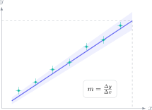

Una gráfica experimental no es un dibujo decorativo. Condensa una relación física, unidades, dispersión e incertidumbre. En PAU, identificar correctamente la pendiente o el área puede convertir una tabla extensa en una magnitud física; hacerlo sin atender a los ejes produce respuestas numéricamente limpias pero conceptualmente falsas.

> **Respuesta directa.** Lee primero variables y unidades, identifica el modelo teórico, calcula la pendiente con dos puntos separados de la recta de ajuste y expresa una conclusión compatible con la incertidumbre. No confundas puntos medidos con puntos exactos de la recta.

## Empieza por los ejes, no por la forma

Anota qué representa cada eje y sus unidades. La pendiente tiene unidades:

$$
[m]=\frac{[y]}{[x]}.
$$

En una gráfica velocidad-tiempo, $[m]=(\mathrm{m\,s^{-1}})/\mathrm{s}=\mathrm{m\,s^{-2}}$, por lo que la pendiente es aceleración. En posición-tiempo, la misma operación produce velocidad. La apariencia de la línea no decide el significado; lo hacen las variables.

El área también hereda unidades. Bajo una curva fuerza-desplazamiento:

$$
\mathrm N\cdot\mathrm m=\mathrm J,
$$

por lo que representa trabajo.

## Calcula la pendiente de la recta, no de dos datos próximos

Elige dos puntos separados que pertenezcan a la recta de mejor ajuste, aunque no coincidan con medidas originales:

$$
m=\frac{y_2-y_1}{x_2-x_1}.
$$

Una separación grande reduce el efecto relativo de leer cada coordenada con una pequeña imprecisión. Dibuja el triángulo de pendiente y conserva unidades durante el cálculo.

## Qué indican las barras de incertidumbre

Una medida $x\pm\Delta x$ representa un intervalo compatible con la resolución o método utilizado. No significa que cualquier valor sea igualmente probable ni que el valor real esté garantizado dentro del intervalo.

Para una sola lectura analógica suele considerarse una fracción razonada de la mínima división; en instrumentos digitales se atiende a la resolución indicada. Sigue siempre el criterio empleado en el enunciado o curso.

La incertidumbre relativa es:

$$
\varepsilon_r=\frac{\Delta x}{|x|},
$$

y la porcentual $100\varepsilon_r\,\%$. Comparar porcentajes permite decidir qué medida limita la precisión del resultado.

## Linealizar para comprobar una ley

Si el modelo es $y=kx^2$, representar $y$ frente a $x$ produce una curva; representar $y$ frente a $x^2$ debe producir una recta de pendiente $k$. Para una ley $T=2\pi\sqrt{L/g}$:

$$
T^2=\frac{4\pi^2}{g}L.
$$

La gráfica $T^2$ frente a $L$ tiene pendiente $4\pi^2/g$, de donde:

$$
g=\frac{4\pi^2}{m}.
$$

El desarrollo demuestra qué se representa y cómo se recupera la magnitud; no basta con afirmar que “sale una recta”.

## Ajuste, dispersión y anomalías

Una recta de ajuste equilibra la tendencia del conjunto; no tiene que pasar por todos los puntos. Un dato alejado no debe eliminarse solo porque incomoda. Revisa lectura, transcripción y procedimiento; si existe una causa experimental justificable, indícala.

No digas que dos valores son “iguales” si solo son compatibles dentro de la incertidumbre. Una conclusión rigurosa sería: “la pendiente experimental es compatible con el valor teórico dentro del intervalo estimado”.

## Cifras significativas y conclusión

La incertidumbre no debe expresarse con precisión artificial. Ajusta el valor a la misma posición decimal y conserva más cifras solo durante los cálculos intermedios.

Termina siempre con tres elementos: magnitud obtenida, unidad y comparación física. Si la ordenada en el origen debería ser cero y no lo es, considera un error sistemático antes de atribuirlo al azar.

El campus virtual de Método Nebula incluye análisis de datos, linealizaciones y preguntas experimentales dentro de cada bloque de Física PAU, con gráficas cuidadas y soluciones justificadas. El botón de contacto permite acceder a ejercicios graduados y simulacros donde cada pendiente, unidad e incertidumbre se interpreta como parte del modelo, no como un trámite gráfico.
