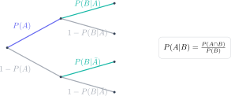

En los problemas de Bayes de Matemáticas Aplicadas a las Ciencias Sociales, la aritmética suele ser sencilla. La dificultad real consiste en traducir “de los que…”, “sabiendo que…” o “si ha ocurrido…” sin invertir la condición. Un árbol bien construido hace visible esa estructura.

> **Respuesta directa.** Define los sucesos, coloca primero la partición inicial, escribe probabilidades condicionadas en la segunda rama y multiplica a lo largo de cada camino. Si la pregunta invierte el orden de la información, aplica Bayes dividiendo la intersección por la probabilidad de la evidencia.

## Tres operaciones que no deben confundirse

La intersección exige que ocurran ambos sucesos:

$$
P(A\cap B)=P(A)P(B|A).
$$

La probabilidad total suma caminos incompatibles que conducen al mismo resultado:

$$
P(B)=P(A)P(B|A)+P(\bar A)P(B|\bar A).
$$

Bayes invierte la condición:

$$
P(A|B)=\frac{P(A)P(B|A)}{P(B)}.
$$

No son tres fórmulas aisladas: Bayes utiliza en el numerador un camino conjunto y en el denominador todos los caminos que producen la evidencia $B$.

## Ejemplo completo: programa de preparación

El 60 % de un grupo utiliza un programa de preparación, suceso $A$. Entre esos alumnos, el 80 % supera una prueba, suceso $B$. Entre quienes no utilizan el programa, la supera el 45 %.

Los datos son:

$$
P(A)=0.60,\quad P(B|A)=0.80,\quad P(B|\bar A)=0.45.
$$

Primero calculamos la probabilidad total de superar la prueba:

$$
P(B)=0.60(0.80)+0.40(0.45)=0.48+0.18=0.66.
$$

Si sabemos que una persona ha superado la prueba, la probabilidad de que utilizara el programa es:

$$
P(A|B)=\frac{0.60(0.80)}{0.66}=\frac{0.48}{0.66}\approx0.7273.
$$

Por tanto, aproximadamente el 72.73 % de quienes superaron la prueba utilizaron el programa. Esta interpretación final es necesaria: el resultado no afirma que el programa garantice aprobar ni demuestra por sí mismo causalidad.

## Cómo dibujar el árbol sin solapamientos conceptuales

La primera bifurcación debe representar sucesos complementarios: $A$ y $\bar A$. Desde cada uno salen $B$ y $\bar B$. Las probabilidades de ramas hermanas suman 1:

$$
P(B|A)+P(\bar B|A)=1.
$$

Multiplica sobre una ruta y suma entre rutas. Escribir esta regla al margen evita sumar dos probabilidades que deberían multiplicarse.

## Método con tabla de frecuencias

Si los porcentajes resultan abstractos, imagina 1000 personas. En el ejemplo, 600 usan el programa: 480 superan la prueba. De las 400 restantes, 180 la superan. Entre las 660 que aprueban, 480 pertenecen al primer grupo:

$$
\frac{480}{660}=0.7273.
$$

La tabla y el árbol deben producir exactamente el mismo resultado. Utilizar ambos como comprobación es especialmente útil cuando hay datos naturales como pacientes, piezas o encuestas.

## Errores frecuentes en PAU

- Interpretar $P(A|B)$ como $P(B|A)$.
- Sumar probabilidades dentro de un camino.
- Olvidar uno de los caminos en la probabilidad total.
- Mezclar porcentajes y decimales en una misma operación.
- Redondear antes de terminar.
- Presentar un porcentaje sin decir a qué población se refiere.

## Comprobaciones rápidas

El denominador de Bayes debe ser al menos tan grande como el numerador porque contiene ese camino y posiblemente otros. El resultado debe estar entre 0 y 1. Además, todas las hojas del árbol deben sumar 1.

El campus virtual de Método Nebula desarrolla probabilidad condicionada, árboles, tablas, teorema de la probabilidad total, Bayes y distribuciones con ejercicios graduados y modelos PAU resueltos. El botón de contacto permite acceder a una ruta que empieza por traducir el lenguaje y termina con problemas cronometrados, para que la fórmula nunca sustituya a la comprensión del suceso.
