En Matemáticas II PAU no solo se evalúa si sabes derivar, integrar o resolver un sistema. También se evalúa de forma indirecta si puedes **seleccionar, desarrollar y revisar** bajo un límite estricto. Un ejercicio dominado que queda sin empezar vale cero; uno bien elegido y presentado con método puede conservar puntos aunque aparezca un error aritmético.

> **Respuesta directa.** Reserva unos 5 minutos para leer y elegir, aproximadamente 70–75 para resolver y al menos 10 para revisar. Reparte el tiempo en proporción a los puntos, pero corrige esa proporción según tu seguridad y la estructura oficial de tu examen.

## Antes del cronómetro: conoce tu estructura

La optatividad y el número de ejercicios pueden variar. Consulta el modelo oficial de tu comunidad y transforma la puntuación en una referencia temporal:

$$
t_i=\frac{p_i}{P}T,
$$

donde $p_i$ es la puntuación del ejercicio, $P$ la puntuación total y $T$ el tiempo realmente disponible para resolver. Si reservas 15 minutos entre lectura y revisión, entonces $T=75$.

Un ejercicio de 2,5 puntos recibiría de partida:

$$
t_i=\frac{2.5}{10}\cdot75=18.75\text{ minutos}.
$$

No es una orden rígida; es una alarma contra dedicar 35 minutos a una cuarta parte del examen.

## Minutos 0–5: lee para decidir

Recorre todas las opciones sin comenzar operaciones largas. En cada ejercicio anota mentalmente:

- qué bloque evalúa;
- cuál sería el primer paso;
- cuántos apartados puedes completar;
- qué riesgo técnico contiene.

Clasifica con tres símbolos: seguro, viable y arriesgado. Empieza por un ejercicio seguro que te permita entrar en ritmo, salvo que su desarrollo sea excesivamente largo.

## Cómo elegir entre dos ejercicios

No elijas por el aspecto familiar del enunciado. Compara la puntuación esperada:

$$
E_i=\sum_j p_{ij}q_{ij},
$$

donde $p_{ij}$ son los puntos del apartado $j$ y $q_{ij}$ tu probabilidad razonable de completarlo. Un ejercicio con tres apartados independientes puede ser mejor que otro cuya segunda mitad depende por completo del primer cálculo.

También cuenta el coste de comprobación. Una integral complicada puede requerir derivar el resultado; un sistema permite sustituir la solución; una probabilidad puede verificarse acotándola entre 0 y 1.

## Durante la resolución: escribe para conservar puntos

Expón el principio antes de operar. Si estudias monotonía, escribe el dominio, calcula $f'(x)$ y construye el signo. Si resuelves geometría, define vectores y ecuaciones antes de imponer la condición. Si aplicas un teorema, comprueba sus hipótesis.

Evita encadenar cinco transformaciones en una sola línea. La presentación escalonada reduce errores y permite que el corrector identifique el método.

## Regla de salida ante un bloqueo

Si pasan 3–4 minutos sin una nueva línea útil, deja espacio, marca el ejercicio y continúa. Antes de salir, escribe cualquier relación correcta que pueda recibir puntuación: la fórmula, el sistema, el dominio o una condición.

Volver más tarde cambia el coste cognitivo. Con otros puntos ya asegurados, puedes analizar el bloqueo sin la sensación de que todo el examen depende de él.

## Últimos 10 minutos: revisión con prioridades

No releas de principio a fin. Busca primero fallos de alto impacto:

1. opciones o apartados sin identificar;
2. signos en derivadas, determinantes e integrales;
3. valores prohibidos y dominios;
4. unidades, redondeo y conclusión;
5. soluciones que no cumplen la ecuación original.

Sustituye las soluciones cuando sea posible. En una integral definida, estima el signo del área; en probabilidad, exige $0\le P\le1$; en geometría, comprueba perpendicularidad con el producto escalar.

## Entrena la estrategia, no solo los temas

Una planificación temporal no se estrena el día de la prueba. Realiza simulacros y registra tiempo planificado, tiempo real, puntos y motivo de cada desvío. Tras varias pruebas aparecerá tu patrón: lentitud algebraica, exceso de revisión temprana o mala elección inicial.

El campus virtual de Método Nebula reúne teoría, ejercicios graduados y exámenes PAU resueltos con indicaciones de tiempo y criterios de corrección. El botón de contacto permite solicitar un diagnóstico para elegir una estrategia de 90 minutos basada en tus bloques fuertes, tus errores recurrentes y el modelo oficial que vas a realizar.
