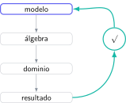

Muchos puntos de Matemáticas II PAU no se pierden por desconocer una fórmula, sino por romper una condición del problema: olvidar el dominio, cambiar un signo, dividir entre una expresión que puede valer cero o terminar sin responder lo que se preguntaba. Son fallos pequeños en apariencia, pero sistemáticos.

> **Respuesta directa.** La solución no es “tener más cuidado” de forma abstracta. Cada error necesita una comprobación observable: sustituir, derivar, imponer dominio, verificar dimensiones o releer la conclusión.

## Errores de planteamiento

### 1. Empezar a calcular sin definir el modelo

En optimización, escribe variable, función objetivo y restricción. Sin esa traducción puedes derivar correctamente una función que no representa el problema.

### 2. Contestar una cuestión distinta

“Halla”, “demuestra”, “discute” e “interpreta” no exigen la misma salida. Subraya el verbo y vuelve a él en la última línea.

### 3. Elegir una opción sin valorar sus apartados

El primer apartado familiar puede ocultar una dependencia difícil. Lee la estructura completa y estima los puntos que puedes asegurar.

## Errores de análisis

### 4. Olvidar el dominio

Antes de límites, continuidad o derivadas, identifica denominadores, raíces pares y logaritmos. Una solución fuera del dominio no se recupera con un cálculo correcto.

### 5. Igualar $f'(x)=0$ y declarar un extremo

Un punto crítico necesita estudio de signo, segunda derivada o comparación según el problema. La ecuación solo produce candidatos.

### 6. Confundir integral con área positiva

La integral definida es área orientada:

$$
\int_a^b f(x)\,dx=A_+-A_-.
$$

Si piden área geométrica, separa los intervalos donde cambia el signo y utiliza valores absolutos.

### 7. No comprobar una primitiva

Deriva el resultado. Esta operación corta detecta signos, factores internos y potencias incorrectas.

## Errores de álgebra y geometría

### 8. Dividir entre una incógnita o parámetro

Si divides entre $x$, $a-1$ o una expresión similar, debes estudiar por separado cuándo vale cero. De lo contrario puedes eliminar soluciones o casos.

### 9. Confundir rango de una matriz con número de incógnitas

En sistemas, compara los rangos de la matriz de coeficientes y ampliada, y relaciónalos con $n$. No basta con calcular un determinante sin interpretar.

### 10. Cambiar el orden en un producto de matrices

En general, $AB\ne BA$. Comprueba dimensiones antes de multiplicar; si no coinciden, la operación ni siquiera está definida.

### 11. Usar un vector normal como vector director

En una recta o plano, escribe qué representa cada vector. La condición de perpendicularidad se comprueba mediante producto escalar igual a cero.

### 12. Aceptar una distancia con signo

Una distancia es no negativa. Si utilizas una expresión orientada, incluye valor absoluto y denominador normalizado cuando corresponda.

## Errores de probabilidad y presentación

### 13. Confundir $P(A|B)$ con $P(B|A)$

Escribe la definición antes de sustituir:

$$
P(A|B)=\frac{P(A\cap B)}{P(B)}.
$$

El denominador identifica claramente la condición.

### 14. Redondear en pasos intermedios

Conserva precisión en la calculadora y redondea al final. En distribuciones, un redondeo temprano puede mover el resultado fuera de la tolerancia.

### 15. Terminar con un número sin interpretación

Una solución debe indicar qué representa, sus unidades si las hay y si cumple restricciones. La frase final conecta el cálculo con el enunciado.

## La lista de comprobación que sí funciona

No intentes revisar quince elementos en cada línea. Asigna una comprobación a cada bloque:

- análisis: dominio, signo y derivación inversa;
- álgebra: dimensiones, sustitución y casos singulares;
- geometría: producto escalar y pertenencia;
- probabilidad: cotas, suma total y condición;
- final: pregunta, unidad y redondeo.

Después de cada simulacro, cuenta errores por categoría. Si un tipo aparece tres veces, crea una tarjeta con un ejemplo y una prueba de control. El objetivo es que el fallo active automáticamente su comprobación.

El campus virtual de Método Nebula trabaja estos errores con desarrollos completos, ejercicios equivalentes y exámenes PAU comentados. Desde el botón de contacto puedes enviar un simulacro corregido y organizar una ruta que no se limite a repetir teoría: identifica dónde se pierden puntos y entrena la comprobación exacta que los recupera.
