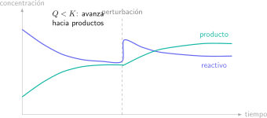

El equilibrio químico no significa que la reacción se haya detenido. Significa que las velocidades directa e inversa son iguales y que las concentraciones macroscópicas permanecen constantes. Entender esta frase evita buena parte de los errores posteriores.

En PAU, el bloque exige conectar tres niveles: la reacción, la composición y la respuesta del sistema a un cambio. **K describe el equilibrio; Q describe el estado actual; Le Châtelier ayuda a predecir cómo responde el sistema.**

## Escribe bien la expresión de equilibrio

Para:

$$
aA+bB\rightleftharpoons cC+dD,
$$

la constante en concentración se expresa como:

$$
K_c=\frac{[C]^c[D]^d}{[A]^a[B]^b}.
$$

Los exponentes proceden de los coeficientes estequiométricos. Los sólidos y líquidos puros no se incluyen en la forma habitual porque su actividad se considera constante.

## K no dice cuánto tarda la reacción

Un valor grande de $K$ indica que el equilibrio favorece productos; un valor pequeño favorece reactivos. No informa de la rapidez. Una reacción puede tener un equilibrio muy desplazado y ser extremadamente lenta.

La temperatura sí puede cambiar $K$. Añadir un catalizador acelera las reacciones directa e inversa, pero no modifica la composición de equilibrio.

## Q decide hacia dónde evoluciona el sistema

El cociente de reacción tiene la misma forma algebraica que $K$, pero se calcula con la composición del instante considerado:

- $Q<K$: el sistema evoluciona hacia productos.
- $Q>K$: evoluciona hacia reactivos.
- $Q=K$: ya está en equilibrio.

Esta comparación debe preceder a una tabla de cambio: te ayuda a asignar correctamente los signos.

## Ejemplo con tabla de equilibrio

Para $\mathrm{H_2+I_2\rightleftharpoons2HI}$, se introducen 1,0 mol/L de $H_2$ y 1,0 mol/L de $I_2$, sin HI inicial. Si en equilibrio han reaccionado $x$ mol/L:

| Especie | Inicial | Cambio | Equilibrio |
|---|---:|---:|---:|
| $H_2$ | 1,0 | $-x$ | $1,0-x$ |
| $I_2$ | 1,0 | $-x$ | $1,0-x$ |
| $HI$ | 0 | $+2x$ | $2x$ |

Entonces:

$$
K_c=\frac{(2x)^2}{(1-x)^2}.
$$

La tabla no es una plantilla decorativa. Codifica la estequiometría y garantiza que las concentraciones finales sean físicamente posibles.

## Le Châtelier sin frases automáticas

Si aumenta la concentración de un reactivo, el sistema tiende a consumir parte de lo añadido. Si disminuye el volumen de un equilibrio gaseoso, se favorece el lado con menor número de moles gaseosos. Si aumenta la temperatura, trata el calor como reactivo o producto según la reacción sea endotérmica o exotérmica.

La palabra “tiende” importa: el sistema compensa parcialmente la perturbación, no la elimina mágicamente.

## Segundo ejercicio resuelto: comparar Q y Kc

Para el equilibrio

$$
\mathrm{H_2(g)+I_2(g)\rightleftharpoons2HI(g)},
$$

$K_c=50$. En un instante, $[H_2]=0.20\ \mathrm M$, $[I_2]=0.20\ \mathrm M$ y $[HI]=1.00\ \mathrm M$.

$$
Q_c=\frac{[HI]^2}{[H_2][I_2]}
=\frac{1.00^2}{(0.20)(0.20)}=25.
$$

Como $Q_c<K_c$, faltan productos respecto al equilibrio. La reacción neta avanza hacia la derecha, consume $H_2$ e $I_2$ y forma más $HI$ hasta que $Q_c=K_c$.

## Tercer ejercicio resuelto: efecto del volumen

En

$$
\mathrm{N_2O_4(g)\rightleftharpoons2NO_2(g)},
$$

una disminución de volumen eleva todas las presiones parciales de forma instantánea. El sistema evoluciona hacia el lado con menos moles gaseosos, la izquierda, y forma más $N_2O_4$. La constante no cambia si la temperatura permanece constante.

## Presión, volumen y gases inertes

Reducir volumen aumenta presiones parciales y puede desplazar el equilibrio si cambia el número total de moles gaseosos entre lados. Añadir un gas inerte a volumen constante no cambia las presiones parciales de las especies reactivas en el modelo ideal, por lo que no desplaza el equilibrio.

Son preguntas frecuentes porque obligan a razonar más allá de una regla memorizada.

## Errores frecuentes

- Incluir sólidos en $K_c$.
- Cambiar $K$ al variar una concentración a temperatura constante.
- Decir que un catalizador “produce más producto”.
- Usar Le Châtelier sin indicar qué variable cambia.
- Resolver una raíz matemática que produce concentración negativa.
- Confundir equilibrio dinámico con ausencia de reacción.

## Práctica de examen

Entrena cuatro formatos: escribir $K$, comparar $Q$ y $K$, resolver una tabla y justificar una perturbación. Después mezcla equilibrio con cinética, termoquímica o ácido-base. En PAU los bloques pueden conectarse y la elección del método cuenta tanto como el cálculo.

El campus virtual de Método Nebula organiza Química PAU desde fundamentos hasta cinética y equilibrio, con ejemplos guiados, ejercicios, preguntas de examen y errores comunes. Si quieres detectar qué decisión falla y convertirla en una secuencia de práctica, utiliza el botón de contacto.
