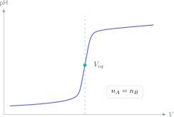

La expresión $M_aV_a=M_bV_b$ solo funciona directamente en casos de proporción 1:1. Utilizarla como regla universal oculta la química de la valoración y falla en ácidos polipróticos, bases con varios hidroxilos y reacciones redox. El método seguro empieza siempre por la reacción ajustada.

> **Respuesta directa.** Escribe y ajusta la reacción, convierte los volúmenes a litros, relaciona los moles mediante los coeficientes estequiométricos y despeja la incógnita. Después justifica el indicador o el método de detección del punto de equivalencia.

## Punto de equivalencia y punto final

En el punto de equivalencia, valorante y analito han reaccionado en la proporción estequiométrica. El punto final es la señal experimental: cambio de color, variación potenciométrica u otra respuesta. Deben estar próximos, pero no son conceptos idénticos.

Si la reacción ajustada es:

$$
\nu_A A+\nu_B B\longrightarrow\text{productos},
$$

en equivalencia se cumple:

$$
\frac{n_A}{\nu_A}=\frac{n_B}{\nu_B}.
$$

Como $n=cV$:

$$
\frac{c_AV_A}{\nu_A}=\frac{c_BV_B}{\nu_B}.
$$

Esta es la relación general; la igualdad directa de productos concentración-volumen es solo el caso $\nu_A=\nu_B$.

## Ejemplo ácido-base

Se valoran $25.00\ \mathrm{mL}$ de ácido sulfúrico con $0.120\ \mathrm{mol\,L^{-1}}$ de hidróxido de sodio. Se consumen $18.40\ \mathrm{mL}$.

La reacción global es:

$$
\mathrm{H_2SO_4+2NaOH\rightarrow Na_2SO_4+2H_2O}.
$$

Moles de base:

$$
n(\mathrm{NaOH})=0.120\cdot0.01840=2.208\times10^{-3}\ \mathrm{mol}.
$$

Por la proporción $1:2$:

$$
n(\mathrm{H_2SO_4})=1.104\times10^{-3}\ \mathrm{mol}.
$$

La concentración es:

$$
c=\frac{1.104\times10^{-3}}{0.02500}=0.04416\ \mathrm{mol\,L^{-1}}.
$$

El factor 2 procede de la ecuación, no de una modificación arbitraria de la fórmula.

## Ejemplo redox: ajusta electrones antes de valorar

En medio ácido, el permanganato oxida hierro(II):

$$
\mathrm{MnO_4^-+8H^++5Fe^{2+}\rightarrow Mn^{2+}+5Fe^{3+}+4H_2O}.
$$

En equivalencia:

$$
n(\mathrm{Fe^{2+}})=5n(\mathrm{MnO_4^-}).
$$

La relación molar aparece al ajustar masa y carga mediante semirreacciones. Si cambian el medio o las especies, puede cambiar la estequiometría; por eso no se memoriza una proporción sin reacción.

## Material y procedimiento que suelen preguntar

La bureta contiene el valorante y permite leer el volumen añadido. La pipeta aforada mide una alícuota precisa del analito. El matraz Erlenmeyer facilita agitar sin perder disolución. Antes de usar cada material se acondiciona de forma coherente con la disolución que contendrá.

Al acercarse al punto final, añade gota a gota y agita. Lee el menisco a la altura de los ojos y registra lectura inicial y final; el volumen gastado es su diferencia.

## Cómo elegir un indicador

El intervalo de viraje debe caer dentro del tramo de cambio brusco de pH. No basta con que el indicador cambie de color “cerca de 7”: una valoración ácido débil-base fuerte tiene equivalencia básica, y una ácido fuerte-base débil, ácida.

En algunas valoraciones redox, el propio reactivo actúa como indicador; en otras se emplea una especie que responde al potencial. La justificación debe vincular señal y equivalencia.

## Errores frecuentes

- Trabajar con mililitros en $n=cV$ sin conversión.
- Usar proporción 1:1 sin ajustar.
- Confundir concentración con cantidad de sustancia.
- Llenar o enjuagar material de manera que diluya la concentración conocida.
- Redondear antes del resultado final.
- Describir un color sin explicar qué marca.

El campus virtual de Método Nebula conecta equilibrio ácido-base, redox, estequiometría y técnicas de laboratorio con ejercicios graduados y modelos PAU resueltos. Desde el botón de contacto puedes acceder a una ruta donde cada volumetría se construye desde la reacción y se comprueba con unidades, proporciones y procedimiento experimental.
