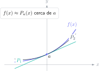

Una serie de Taylor no es una lista para memorizar. Es una manera de sustituir una función difícil por un polinomio fácil cerca de un punto. Esa idea permite aproximar valores, estudiar sensibilidad, linealizar modelos y estimar el error cometido. Por eso aparece en Cálculo, Métodos Numéricos, Física y casi cualquier grado de Ingeniería.

Alrededor de $a$, el polinomio de Taylor de orden $n$ es

$$
P_n(x)=\sum_{k=0}^{n}\frac{f^{(k)}(a)}{k!}(x-a)^k.
$$

Cuando $a=0$ recibe el nombre de polinomio de Maclaurin. La aproximación mejora cerca del centro y, en general, al aumentar el orden.

## Ejercicio resuelto 1: aproximar $e^{0,2}$

Para $f(x)=e^x$, todas las derivadas valen $e^x$ y en $0$ valen $1$. El desarrollo de Maclaurin empieza así:

$$
e^x=1+x+\frac{x^2}{2!}+\frac{x^3}{3!}+\cdots
$$

Con orden tres y $x=0,2$:

$$
e^{0,2}\approx 1+0,2+\frac{0,2^2}{2}+\frac{0,2^3}{6}
=1,221\overline{3}.
$$

El valor real es aproximadamente $1,2214$, así que el error es pequeño. Aquí funciona bien porque $0,2$ está cerca de cero. Usar el mismo polinomio para aproximar $e^5$ sería una mala decisión si el orden es bajo.

## Ejercicio resuelto 2: desarrollo de $\ln(1+x)$

Para $f(x)=\ln(1+x)$, las primeras derivadas en $0$ son

$$
f(0)=0,\quad f'(0)=1,\quad f''(0)=-1,\quad f'''(0)=2.
$$

Por tanto,

$$
\ln(1+x)\approx x-\frac{x^2}{2}+\frac{x^3}{3}.
$$

Si queremos estimar $\ln(1,1)$, tomamos $x=0,1$:

$$
\ln(1,1)\approx0,1-0,005+0,000\overline{3}=0,09533\overline{3}.
$$

El resultado es coherente con que $\ln(1,1)$ sea positivo y menor que $0,1$. Ese control de orden de magnitud es parte de una solución rigurosa.

## Ejercicio resuelto 3: elegir un centro inteligente

Queremos aproximar $\sqrt{4,1}$. Desarrollar $\sqrt{x}$ alrededor de $0$ no es cómodo, pero $4,1$ está muy cerca de $4$. Con $f(x)=\sqrt{x}$ y $a=4$:

$$
f(4)=2,\qquad f'(4)=\frac14.
$$

El Taylor lineal es

$$
P_1(x)=2+\frac14(x-4).
$$

Así,

$$
\sqrt{4,1}\approx2+\frac14(0,1)=2,025.
$$

El mensaje no es “aplica siempre Maclaurin”, sino “desarrolla cerca del dato que quieres aproximar”. Elegir bien $a$ reduce el número de términos necesarios.

## Cómo justificar el error

El resto de Lagrange para un Taylor de orden $n$ es

$$
R_n(x)=\frac{f^{(n+1)}(\xi)}{(n+1)!}(x-a)^{n+1},
$$

para algún $\xi$ entre $a$ y $x$. No suele conocerse $\xi$, pero sí se puede acotar la derivada en el intervalo. Para $e^x$ en $[0,0,2]$, $e^{\xi}\le e^{0,2}<1,23$. En la aproximación de orden tres anterior:

$$
|R_3(0,2)|\le\frac{1,23\,(0,2)^4}{4!}<0,000083.
$$

Una aproximación sin control del error es una estimación; con una cota se convierte en un resultado defendible.

## Errores que restan puntos

- Olvidar el factorial de cada término.
- Derivar correctamente pero evaluar las derivadas en un punto distinto de $a$.
- Confundir $x$ con $(x-a)$.
- Aplicar una serie fuera de su intervalo de convergencia sin justificarlo.
- Dar muchos decimales sin decir qué orden de Taylor se ha usado ni cuánto puede fallar.

El [campus virtual de Método Nebula](/contacto/) reúne explicaciones visuales de Cálculo, hojas de ejercicios con dificultad progresiva y problemas de examen desarrollados. Así puedes practicar no solo el desarrollo, sino la elección del modelo y la estimación de su error.
