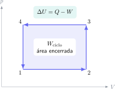

En Termodinámica, un signo mal elegido puede cambiar por completo la interpretación física. Antes de calcular, fija el sistema y la convención. En este artículo usaremos $W>0$ cuando el gas realiza trabajo sobre el exterior; entonces el primer principio es

$$
\Delta U=Q-W.
$$

La ecuación dice que la energía interna aumenta si entra calor y disminuye si el sistema hace trabajo, salvo que el otro término compense ese efecto. No es una fórmula para sustituir números: es el balance energético del sistema.

## Ejercicio resuelto 1: calentamiento a volumen constante

Un gas recibe $600\,\mathrm{J}$ de calor en un recipiente rígido. Como el volumen no cambia,

$$
W=\int p\,dV=0.
$$

Aplicando el primer principio,

$$
\Delta U=Q-W=600-0=600\,\mathrm{J}.
$$

Todo el calor recibido incrementa la energía interna. En un proceso isocórico, recordar $W=0$ simplifica muchos ejercicios, pero solo porque el sistema no puede expandirse ni comprimirse.

## Ejercicio resuelto 2: expansión isobárica

Un gas se expande a presión constante $p=2,0\times10^5\,\mathrm{Pa}$ desde $3,0\,\mathrm{L}$ hasta $5,5\,\mathrm{L}$ y absorbe $900\,\mathrm{J}$ de calor. Primero convertimos el cambio de volumen:

$$
\Delta V=2,5\,\mathrm{L}=2,5\times10^{-3}\,\mathrm{m^3}.
$$

El trabajo hecho por el gas es

$$
W=p\Delta V=(2,0\times10^5)(2,5\times10^{-3})=500\,\mathrm{J}.
$$

Por tanto,

$$
\Delta U=900-500=400\,\mathrm{J}.
$$

El gas recibió $900\,\mathrm{J}$, pero $500\,\mathrm{J}$ salieron como trabajo. El resultado positivo de $\Delta U$ indica que aun así quedó energía almacenada en el sistema.

## Ejercicio resuelto 3: trabajo de un ciclo rectangular

En un diagrama $p-V$, un ciclo rectangular opera entre $p_\text{alta}=300\,\mathrm{kPa}$, $p_\text{baja}=100\,\mathrm{kPa}$ y entre $V_\text{pequeño}=1,0\,\mathrm{L}$ y $V_\text{grande}=4,0\,\mathrm{L}$. El trabajo neto es el área:

$$
W_\text{ciclo}=(p_\text{alta}-p_\text{baja})(V_\text{grande}-V_\text{pequeño}).
$$

Con unidades SI,

$$
W_\text{ciclo}=(2,0\times10^5)(3,0\times10^{-3})=600\,\mathrm{J}.
$$

Si el recorrido es horario, el gas entrega trabajo neto y el valor es positivo con nuestra convención. Si se recorre al revés, el entorno realiza trabajo sobre el gas y el signo cambia.

## Ejercicio resuelto 4: eficiencia de una máquina térmica

Una máquina absorbe $Q_h=1200\,\mathrm{J}$ de la fuente caliente y expulsa $Q_c=750\,\mathrm{J}$ a la fría. En un ciclo $\Delta U=0$, luego

$$
W=Q_h-Q_c=450\,\mathrm{J}.
$$

La eficiencia es

$$
\eta=\frac{W}{Q_h}=\frac{450}{1200}=0,375=37,5\%.
$$

Nunca escribas una eficiencia mayor que $100\%$: vulneraría el balance energético. Además, en motores reales parte del calor siempre se rechaza a un foco frío.

## Método de resolución riguroso

1. Dibuja los estados inicial y final o el diagrama $p-V$.
2. Escribe el primer principio con la convención indicada.
3. Decide si el trabajo es $p\Delta V$, un área bajo una curva o cero.
4. Convierte litros a metros cúbicos y kilopascales a pascales antes de multiplicar.
5. Interpreta el signo final: ¿entra o sale energía?, ¿quién realiza el trabajo?

En el [campus virtual de Método Nebula](/contacto/) encontrarás problemas de Física y Termodinámica resueltos desde el diagrama hasta la comprobación de unidades. Practicar esa secuencia evita que la termodinámica se reduzca a un formulario desconectado del sistema físico.
