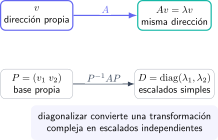

Los valores propios dejan de parecer una definición abstracta cuando se interpretan como lo que son: direcciones que una transformación lineal no gira, sino que únicamente estira, contrae o invierte. En Ingeniería aparecen al estudiar estabilidad, vibraciones, sistemas diferenciales, mecánica estructural o tratamiento de datos. En un examen, la dificultad suele estar menos en el determinante que en ordenar bien el procedimiento.

La pregunta clave es siempre la misma: ¿qué vectores $v\ne0$ cumplen que $Av$ sigue apuntando en la misma dirección? La respuesta se escribe

$$
Av=\lambda v,
$$

donde $\lambda$ es un valor propio y $v$ su vector propio asociado.

## El algoritmo que conviene automatizar

Al llevar todos los términos a un lado se obtiene

$$
(A-\lambda I)v=0.
$$

Para que este sistema homogéneo tenga una solución no nula, la matriz debe ser singular. Por ello los valores propios se calculan con el polinomio característico:

$$
\det(A-\lambda I)=0.
$$

Después se resuelve $(A-\lambda I)v=0$ **por separado para cada raíz**. Una vez encontradas suficientes direcciones independientes, se forma la matriz $P$ con esos vectores como columnas y se verifica

$$
A=PDP^{-1},\qquad D=\operatorname{diag}(\lambda_1,\ldots,\lambda_n).
$$

No inviertas $P$ antes de comprobar que sus columnas son independientes: si no lo son, no hay diagonalización de ese tipo.

## Ejercicio resuelto 1: una matriz $2\times2$

Sea

$$
A=\begin{pmatrix}4&1\\2&3\end{pmatrix}.
$$

Primero calculamos

$$
\det(A-\lambda I)=
\begin{vmatrix}4-\lambda&1\\2&3-\lambda\end{vmatrix}
=(4-\lambda)(3-\lambda)-2
=\lambda^2-7\lambda+10.
$$

Las raíces son $\lambda_1=5$ y $\lambda_2=2$. Para $\lambda_1=5$:

$$
(A-5I)v=\begin{pmatrix}-1&1\\2&-2\end{pmatrix}
\begin{pmatrix}x\\y\end{pmatrix}=0,
$$

de donde $x=y$. Podemos escoger $v_1=(1,1)$. Para $\lambda_2=2$ aparece $2x+y=0$, así que sirve $v_2=(1,-2)$. Como son dos vectores propios independientes en dimensión dos, $A$ es diagonalizable y

$$
P=\begin{pmatrix}1&1\\1&-2\end{pmatrix},
\qquad D=\begin{pmatrix}5&0\\0&2\end{pmatrix}.
$$

El orden de las columnas de $P$ y el de la diagonal de $D$ debe coincidir. Cambiar uno sin cambiar el otro es un error habitual.

## Ejercicio resuelto 2: ¿cuándo falla la diagonalización?

Considera

$$
B=\begin{pmatrix}3&1\\0&3\end{pmatrix}.
$$

El polinomio característico es $(3-\lambda)^2$, por lo que el único valor propio es $\lambda=3$ con multiplicidad algebraica dos. Sin embargo,

$$
B-3I=\begin{pmatrix}0&1\\0&0\end{pmatrix},
$$

y el sistema impone $y=0$, mientras que $x$ es libre. Los vectores propios son múltiplos de $(1,0)$: solo hay una dirección independiente. Por tanto $B$ **no** es diagonalizable.

Una raíz repetida no implica automáticamente un problema. Lo decisivo es la dimensión del espacio propio, es decir, cuántos vectores propios independientes aporta.

## Ejercicio resuelto 3: potencias de una matriz

Si una matriz está diagonalizada, sus potencias se simplifican mucho:

$$
A^n=PD^nP^{-1}.
$$

Para la matriz del primer ejercicio,

$$
D^n=\begin{pmatrix}5^n&0\\0&2^n\end{pmatrix}.
$$

No es necesario multiplicar $A$ por sí misma $n$ veces. Esta idea explica por qué la diagonalización es útil al analizar sistemas discretos $x_{n+1}=Ax_n$: cada dirección propia evoluciona simplemente multiplicándose por $\lambda^n$.

## Checklist de examen

- Escribe $A-\lambda I$, no $A-\lambda$.
- Resuelve el sistema para cada valor propio, incluso si la raíz se repite.
- Distingue multiplicidad algebraica (en el polinomio) y geométrica (número de direcciones independientes).
- Comprueba que $P$ es invertible antes de declarar la diagonalización.
- Haz una verificación rápida: $AP=PD$ suele ser más limpia que desarrollar $PDP^{-1}$.

En el [campus virtual de Método Nebula](/contacto/) puedes trabajar álgebra lineal con teoría corta, ejercicios graduados y correcciones que explican por qué cada paso es válido. Es la forma más segura de convertir un procedimiento mecánico en una herramienta para resolver problemas reales de Ingeniería.
